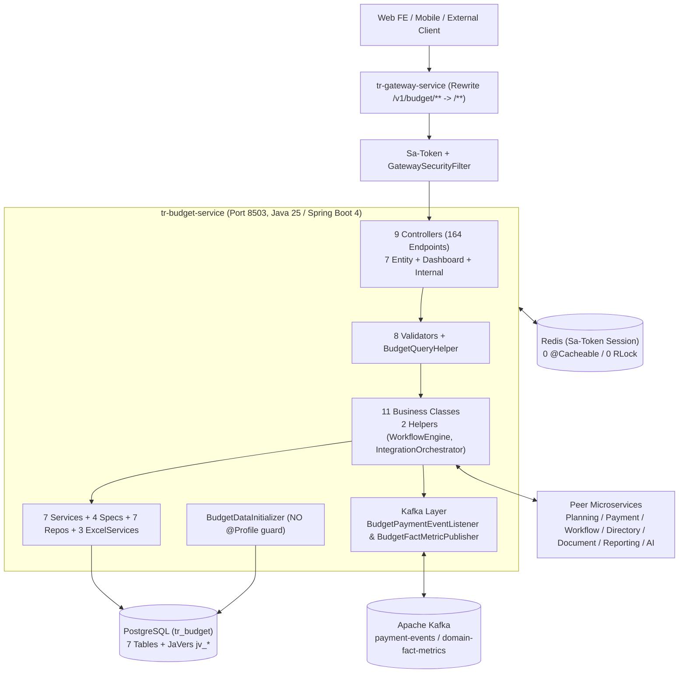

# Đánh giá Kiến trúc, Cấu hình Đa Tenant, Gateway & CI/CD (`tr-budget-service`)

> **Phạm vi kiểm toán**: `tr-business-services/tr-budget-service` (Port `8503`, Service Code `507`, Gateway prefix `/v1/budget`, CSDL gốc `tr_budget`) cùng cấu hình Spring Cloud Config (`config/_base`, `config/dev`, `config/ict-dng`, `config/sct`, `config/sgtvt`), Gateway (`tr-gateway-service`), Docker Compose và CI/CD (`Jenkinsfile`, `Dockerfile`, `tr-budget-service.sh`, `pom.xml`, `settings.xml`).
>
> **Ngày kiểm toán**: 2026-11-26 | **Chế độ**: Chỉ đọc & Đánh giá (không sửa mã nguồn).

## 1. Tổng quan Điểm số & Nhận định

| Tiêu chí | Điểm (`/10`) | Nhận định nhanh |
| --- | --- | --- |
| Kiến trúc phân tầng ứng dụng | 6.5 / 10 | Bám sát chuẩn 5 tầng của `tr-pro-app`, phân tách rõ CRUD/Tree/Batch/Dashboard/Internal; tuy nhiên có 2 God class và trộn lẫn logic khởi tạo dữ liệu mẫu vào runtime production. |
| Cấu hình đa Tenant & Config Server | 4.5 / 10 | Có `_base`, `dev`, `ict-dng`; nhưng thiếu hẳn config cho 5 môi trường trong Jenkins (`sct`, `sgtvt`, `stttt`, `uat`, `prod`), lệch tên service Eureka và lộ nhiều mật khẩu cứng. |
| Tích hợp API Gateway | 7.0 / 10 | Route `/v1/budget/**` và Swagger `/v3/api-docs/v1/budget` nhất quán trên các tenant đã khai báo; Gateway đã chặn `/internal/**` từ ngoài vào. |
| Đóng gói, Vận hành & CI/CD | 3.0 / 10 | `Dockerfile` multi-stage non-root tốt, nhưng `Jenkinsfile` bị copy-paste sai cổng `8306`/container `dev-planning`, lộ Telegram Token & Sonatype/Nexus credentials, tắt SSL và bỏ qua test mặc định. |
| **Tổng điểm Kiến trúc & Hạ tầng** | **5.2 / 10** | **Không an toàn để triển khai tự động qua `Jenkinsfile` hiện tại; cần vá khẩn cấp CI/CD, bí mật cấu hình và hồ sơ đa tenant.** |

## 2. Kiến trúc Phân tầng & Định danh Dịch vụ

### 2.1 Hồ sơ Định danh Microservice

- **Maven Artifact**: `io.github.tyran8x:tr-budget-service:4.2.0.20261125.2` (`pom.xml:6-14`), Java `25`, Spring Boot `4.x`.
- **Tên ứng dụng & Cổng**: `spring.application.name=tr-budget-service`, `server.port=8503` (`src/main/resources/application.yml:2-13`, `config/_base/tr-budget-service.yml:1-13`).
- **Bootstrap class**: `TrBudgetServiceApplication.java:20-35` kích hoạt `@EnableDiscoveryClient`, `@EnableFeignClients(basePackages = {"vn.tr.common.feign"})`, `@EnableScheduling`, `@EnableJpaRepositories`, `@EntityScan`.
- **Standalone Local Mode**: `LocalStandaloneConfig.java:37-288` (`@Profile("local")`) tự nạp stub cho `WorkflowFeignClient`, `CoreUserClient`, `DirectoryNodeClient`, `DirectoryPersonClient`, `UnifiedIdentityResolver`, `KafkaTemplate` khi chạy cục bộ (`application-local.yml:1-60` tắt Eureka, Config Server, Kafka, Redisson).

### 2.2 Sơ đồ Kiến trúc Tổng thể

### 2.3 Điểm mạnh Kiến trúc

1. **Chuẩn hóa kế thừa `tr-common-*`**: Tái sử dụng `BaseController`, `AbstractWorkflowBusiness`, `GenericServiceImpl`, `GlobalAuditController`, `GlobalExcelService`, `AppIsolatedListener` và Hibernate `appCodeFilter`.
2. **Tách biệt nhóm nghiệp vụ cây & nhập liệu hàng loạt**: Đã tách `BudgetEstimateTreeOpsBusiness`, `BudgetEstimateTreeSyncBusiness`, `BudgetBatchEntryBusiness` và `BudgetDashboardBusiness` khỏi `BudgetEstimateItemBusiness` để giảm tải một phần.
3. **Tách riêng tầng Local Standalone**: `LocalStandaloneConfig.java` giúp chạy và kiểm thử cục bộ trên H2 mà không phụ thuộc hạ tầng phân tán.

## 3. Phân tích Cấu hình Đa Tenant & API Gateway

### 3.1 Ma trận Cấu hình Theo Môi trường

| Môi trường / Tenant | File Config (`tr-budget-service`) | Tên DB mặc định | `ddl-auto` | `flyway.enabled` | Gateway Route | Ghi chú rủi ro |
| --- | --- | --- | --- | --- | --- | --- |
| Local defaults | `src/main/resources/application.yml` | `tr_budget` | `update` (dòng 69) | `false` (dòng 77) | N/A | `BUDGET_PAYMENT_KAFKA_ENABLED:false` (dòng 181), `/actuator/**` trong `security.excludes` (dòng 201) |
| Local profile | `src/main/resources/application-local.yml` | H2 in-memory | `create-drop` (dòng 35) | `false` | N/A | Chạy standalone ổn định |
| `_base` | `config/_base/tr-budget-service.yml` | `tr_budget` | `update` (dòng 57) | không bật | `lb://tr-budget-service` | `SA_TOKEN_SAME_SECRET:` rỗng (dòng 140), `is-check-redis: false` (dòng 142), `health.show-details: always` (dòng 239) |
| `dev` | `config/dev/tr-budget-service-dev.yml` | `dev_budget_service` | `update` (dòng 26) | không bật | `lb://${BUDGET_SERVICE_NAME:tr-budget-service}` | `reporting-service-name: dev-reporting-service` (dòng 83), `exposure.include: '*'` (dòng 92), mật khẩu cứng `DnictPro@123` |
| `ict-dng` | `config/ict-dng/tr-budget-service-ict-dng.yml` | `ict_dng_budget_service` | `update` (dòng 24) | không bật | `lb://${BUDGET_SERVICE_NAME:tr-budget-service}` | Mật khẩu DB & Redis hardcode (`IctDng2026!@#`, `DnictProSecurePass123!-ICT-DNG`) |
| `sct` | **KHÔNG TỒN TẠI** | N/A | N/A | N/A | Có route trong `tr-gateway-service-sct.yml` | `config/sct/tr-workflow-service-sct.yml:70` trỏ tới `sct-budget-service` (lệch tên!) |
| `sgtvt` | **KHÔNG TỒN TẠI** | N/A | N/A | N/A | Có route trong `tr-gateway-service-sgtvt.yml` | `config/sgtvt/tr-workflow-service-sgtvt.yml:70` trỏ tới `sgtvt-budget-service` (lệch tên!) |
| `stttt` / `uat` / `prod` | **KHÔNG TỒN TẠI** | N/A | N/A | N/A | Chưa có cấu hình riêng | Liệt kê trong `Jenkinsfile:38` nhưng không có file config |

### 3.2 Cấu hình API Gateway & Init DB

- **Gateway Routing**: Đã cấu hình đầy đủ 2 route cho từng môi trường (`tr-gateway-service/src/main/resources/application.yml:259-264,493-498,658-659` và các file `config/{_base,dev,ict-dng,sct,sgtvt}/tr-gateway-service*.yml`):
  - Route API: `/v1/budget/**` -> `RewritePath=/v1/budget/(?<path>.*), /${path}` -> `lb://tr-budget-service`.
  - Route OpenAPI: `/v3/api-docs/v1/budget` -> `RewritePath` về `/v3/api-docs`.
- **Database Init Scripts**: `docker/dev/init-scripts/01-init.sql:24` khởi tạo `dev_budget_service`, `docker/ict-dng/db-server/init-scripts/01-init.sql:11` khởi tạo `ict_dng_budget_service`.
- **Docker Compose (`ict-dng`)**: `docker/ict-dng/app-server/docker-compose.yml:529-554` khai báo service `ict-dng-budget-service` cổng `8503`, nhưng dùng image `tyran8x/tr-budget:${IMAGE_TAG:-latest}` (dòng 531) — **không khớp** với tên image mà `Jenkinsfile:162` build là `tyran8x/tr-budget-service`.

## 4. Đánh giá CI/CD, Dockerfile, Startup Script & Logging

### 4.1 `Jenkinsfile` — Lỗi Copy-Paste Nghiêm trọng

- **Triển khai nhầm sang `tr-planning-service` (`Jenkinsfile:164-179`)**:
  - Publish cổng `8306:8306` thay vì `8503:8503`.
  - Chạy `docker compose up -d dev-planning` và kiểm tra container `dev-planning-service` trên `http://localhost:8306/actuator/health`.
  - Nếu chạy pipeline Jenkins hiện tại, bản build của `tr-budget-service` sẽ cố ghi đè hoặc kiểm tra sức khỏe của dịch vụ `tr-planning-service`!
- **Lộ bí mật trong mã nguồn (`Jenkinsfile:29-30`)**: Hardcode trực tiếp `TELEGRAM_BOT_TOKEN = '8423245923:AAFHSTIpl6A5vsbkRbYDMqkPw73t5PKP34E'` và `TELEGRAM_CHAT_ID = '-1003054884531'`.
- **Bỏ qua kiểm tra chất lượng & bảo mật vận chuyển (`Jenkinsfile:32,42`)**:
  - `MAVEN_OPTS` tắt hoàn toàn xác thực chứng chỉ SSL (`-Dmaven.wagon.http.ssl.insecure=true -Dmaven.wagon.http.ssl.allowall=true -Dmaven.wagon.http.ssl.ignore.validity.dates=true`).
  - `SKIP_TESTS` đặt `defaultValue: true` khiến CI mặc định không chạy unit test.
- **Image chạy quyền `root` (`Jenkinsfile:161`)**: Tự sinh `Dockerfile.deploy` inline chạy trực tiếp `java -jar` với quyền `root`, bỏ qua hoàn toàn `Dockerfile` chuẩn đã có `USER appuser`.

### 4.2 `Dockerfile`, `settings.xml`, `tr-budget-service.sh` & `logback-spring.xml`

- **`Dockerfile`**: Thiết kế multi-stage (`Dockerfile:1-60`), tách Spring Boot layers (`dependencies`, `spring-boot-loader`, `snapshot-dependencies`, `application`), chạy `USER appuser` (dòng 48), cấu hình `HEALTHCHECK` trên cổng `8503` (dòng 54-56) và `UseG1GC`. Điểm trừ: `Dockerfile:4` dùng tag `maven:3.10.0-eclipse-temurin-25-alpine` (cần kiểm chứng tồn tại trên registry nội bộ) và `Dockerfile:21` truyền `-DskipTests`.
- **`settings.xml` (`settings.xml:6-25,33,46,97`)**: Chứa mật khẩu plaintext của cả Nexus (`tr-deloyment`/`DnictPro@123`) lẫn **Sonatype Maven Central** (`central`: `qZWt17` / `3vHJBiq1727jj7DRI7Cc4qhb9SssUXtb1`), và kết nối Nexus qua HTTP không mã hóa (`http://49.156.54.118/nexus/repository/tr-public/`).
- **`tr-budget-service.sh`**:
  - Dòng `14`: `JAVA_OPTS="-Xms256m -Xmx512m -XX:+UseSerialGC"` — sử dụng SerialGC đơn luồng và heap tối đa chỉ `512MB`, dễ gây `OutOfMemoryError` hoặc pause dài khi tổng hợp báo cáo/cây dự toán cuối năm.
  - Dòng `161, 188`: Ép `-DJPA_DDL_AUTO=update` và `-Dspring.jpa.hibernate.ddl-auto=update` trong cả hàm chạy thường và chạy ngầm.
  - Dòng `259`: `pgrep -f "$APP_NAME.jar"` sẽ kết thúc **mọi** tiến trình `tr-budget-service.jar` trên máy chủ kể cả khác tenant/profile.
- **`logback-spring.xml`**:
  - Dòng `7`: `defaultValue="tr-evaluation-service"` (lỗi copy-paste tên service).
  - Dòng `91, 100`: `<neverBlock>false</neverBlock>` trên `ASYNC_INFO` và `ASYNC_ERROR` có thể làm treo luồng HTTP khi hàng đợi log đầy.
  - Dòng `99`: `<includeCallerData>true</includeCallerData>` gây chi phí chụp stacktrace lớn khi có nhiều lỗi.
  - Dòng `118`: `<logger name="vn.tr" level="DEBUG"/>` cố định mức `DEBUG` cho mọi môi trường, tăng mạnh I/O đĩa và nguy cơ lộ dữ liệu nhạy cảm.
- **`BudgetDataInitializer.java:36`**: Đánh dấu `@Component` **không có `@Profile`** (ví dụ `@Profile({"local", "dev"})`), nên `CommandLineRunner` (1.249 dòng) sẽ tự thực thi cả trên **Production** nếu bảng danh mục trống, chèn dữ liệu thật/cá nhân (`Đinh Quang Huy`, `huydq1@danang.gov.vn`, `0400238912`) và các mã enum/công thức không hợp lệ (`"SUM_CHILDREN"`, `"DIRECTORATE"`, `"UNIT_SELF"`, `"SUBMITTED"`).

## 5. Danh mục Phát hiện & Xếp hạng Mức độ

| Mã lỗi | Mức độ | Vị trí (`file:line`) | Mô tả vấn đề | Khuyến nghị khắc phục |
| --- | --- | --- | --- | --- |
| `ARCH-C01` | **CRITICAL** | `Jenkinsfile:161-179` | Pipeline deploy trỏ nhầm cổng `8306`, service `dev-planning`, container `dev-planning-service` của `tr-planning-service`; đồng thời dựng `Dockerfile.deploy` chạy `root` và lệch tên image với `docker-compose.yml:531`. | Sửa về cổng `8503`, service `tr-budget-service`, thống nhất tên image và dùng trực tiếp `Dockerfile` multi-stage non-root. |
| `ARCH-C02` | **CRITICAL** | `Jenkinsfile:29-32`; `settings.xml:6-25` | Lộ Telegram Bot Token, Maven Central Sonatype token và Nexus credentials trong Git; tắt SSL verification khi build Maven. | Thu hồi ngay toàn bộ token bị lộ, chuyển sang Jenkins Credentials / Vault và bật HTTPS + xác thực SSL. |
| `ARCH-H01` | **HIGH** | `BudgetDataInitializer.java:36` | Bộ seed dữ liệu mẫu (1.249 LOC) không có `@Profile` guard -> tự chạy ở Production, chèn dữ liệu cá nhân và chuỗi enum/formula sai chuẩn. | Giới hạn `@Profile({"local", "dev"})` kèm cờ `budget.seed.enabled=false` mặc định; ẩn danh hóa dữ liệu mẫu và sửa khớp enum/validator. |
| `ARCH-H02` | **HIGH** | `config/` & `Jenkinsfile:38`; `config/sct/tr-workflow-service-sct.yml:70`; `config/sgtvt/tr-workflow-service-sgtvt.yml:70` | Thiếu 5 file config tenant (`sct`, `sgtvt`, `stttt`, `uat`, `prod`); `Jenkinsfile` thiếu `ict-dng`; lệch tên Eureka (`sct-budget-service`, `sgtvt-budget-service`, `dev-reporting-service`). | Chuẩn hóa tên dịch vụ trên Config Server (`tr-budget-service` hoặc biến `${BUDGET_SERVICE_NAME}`), bổ sung đủ config tenant trước khi mở CI/CD. |
| `ARCH-H03` | **HIGH** | `tr-budget-service.sh:14,161,188,259` | Dùng `SerialGC` + `-Xmx512m`, ép `ddl-auto=update` và `pgrep -f` có thể tắt nhầm instance tenant khác trên cùng host. | Đổi sang `G1GC`, `-Xms512m -Xmx1536m`, bỏ ép `ddl-auto=update`, dùng PID file riêng theo profile/port. |
| `ARCH-M01` | **MEDIUM** | `logback-spring.xml:7,91,99-100,118`; `Jenkinsfile:42`; `Dockerfile:21` | `defaultValue="tr-evaluation-service"`, `neverBlock=false`, `vn.tr=DEBUG` cố định, `SKIP_TESTS=true` mặc định. | Sửa `defaultValue="tr-budget-service"`, đặt `neverBlock=true`, `vn.tr=INFO` mặc định (chỉ `DEBUG` ở local/dev), bật test gate bắt buộc trong CI. |
