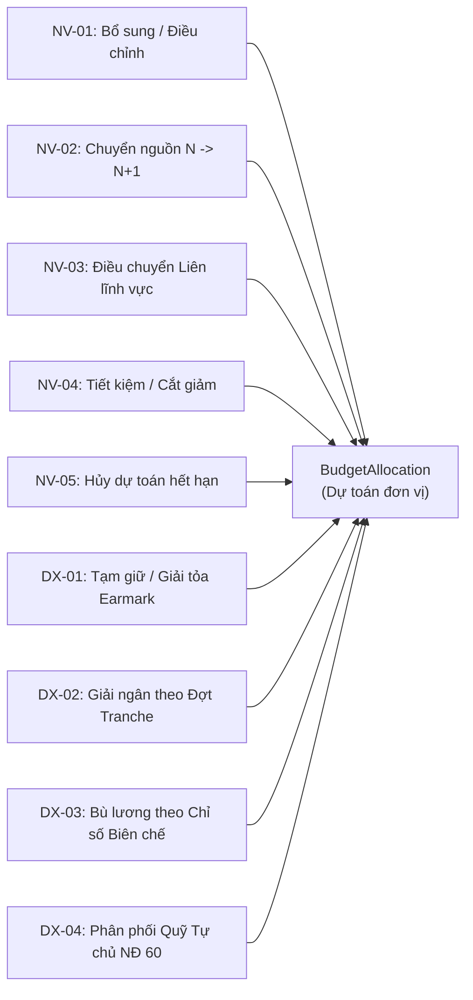

# Đánh giá Nghiệp vụ Quản lý Ngân sách & Tự chủ Tài chính (`tr-budget-service`)

> **Phạm vi kiểm toán**: Mức độ tuân thủ Luật Ngân sách Nhà nước 2015 (Luật 83/2015/QH13), Nghị định 60/2021/NĐ-CP (cơ chế tự chủ tài chính đơn vị sự nghiệp công lập Nhóm 1–4), Thông tư 324/2016/TT-BTC (Mục lục NSNN), quy trình KBNN DVC và các nhóm nghiệp vụ sổ cái `NV-01..NV-05`, `DX-01..DX-04`, Báo cáo tài chính định kỳ.
>
> **Ngày kiểm toán**: 2026-11-26 | **Chế độ**: Chỉ đọc & Đánh giá (không sửa mã nguồn).

## 1. Tổng quan Điểm số & Bản đồ Miền Nghiệp vụ

| Phân hệ Nghiệp vụ | Điểm (`/10`) | Nhận định nhanh |
| --- | --- | --- |
| Mục lục NSNN (`BudgetCategory`) & Cấu hình Tự chủ (`BudgetUnitConfig`) | 7.5 / 10 | Mô hình hóa tốt cấu trúc Chương–Loại–Khoản–Mục–Tiểu mục và 4 nhóm tự chủ theo NĐ 60/2021; còn thiếu ràng buộc hiệu lực theo niên độ và chuẩn hóa quy tắc chuyển nguồn mặc định. |
| Cây Dự toán Thu–Chi Đa cấp (`BudgetEstimateItem`) | 6.8 / 10 | Hỗ trợ cây nhiều cấp, phân tách niên độ (`V303_003`), kéo thả sắp xếp và công thức DSL; nhưng backend chưa thực thi công thức tùy biến và cho phép chỉnh sửa không khóa sau khi giao dự toán. |
| Phân bổ Dự toán (`BudgetAllocation`) | 6.0 / 10 | Có đầy đủ cột đầu năm, bổ sung, chuyển nguồn, điều chỉnh, hiệu lực, cam kết, tạm giữ, giải ngân, khả dụng và liên kết Kế hoạch (`tr-planning-service`); nhưng sai trạng thái workflow khi chuyển bước và thiếu chốt sổ kỳ. |
| Sổ cái Bút toán Kép (`BudgetTransaction`: NV-01..05, DX-01..04) | 4.5 / 10 | Ý tưởng bao phủ đầy đủ nghiệp vụ kho bạc/tài chính công; nhưng nhiều hàm thực thi có lỗi toán học và vi phạm chế độ tài chính (tự sinh dự toán nguồn ở NV-02, hardcode cap 3 đơn vị ở DX-03, phân phối quỹ âm/lặp vô hạn ở DX-04). |
| Giải ngân, Cam kết chi, Tạm ứng & Quyết toán KBNN (`BudgetDisbursement`) | 5.5 / 10 | Phản ánh đúng luồng Cam kết chi -> Tạm ứng -> Thanh toán tạm ứng -> Quyết toán KBNN DVC; nhưng đếm trùng `ADVANCE_SETTLEMENT`, thiếu kiểm soát hạn mức khi duyệt và hardcode tài khoản kho bạc giả. |
| Báo cáo Định kỳ & Đối chiếu KBNN (`BudgetReport`) | 6.2 / 10 | Có bảng tổng hợp dự toán, đối chiếu KBNN (Mẫu 01/02) và tỷ lệ giải ngân; nhưng cột tạm ứng `expAdv` luôn bằng 0, cộng sai dấu `carryOverOut` và chứa nhánh hardcode ngày `23/10`. |
| **Tổng điểm Nghiệp vụ** | **6.1 / 10** | **Thiết kế mô hình miền rất phong phú và bám sát thực tiễn hành chính sự nghiệp Việt Nam, nhưng phần thực thi quy tắc tài chính còn nhiều sai lệch cần chuẩn hóa.** |

## 2. Đánh giá Chi tiết Từng Phân hệ Nghiệp vụ

### 2.1 Mục lục NSNN (`BudgetCategory`) & Tự chủ Tài chính NĐ 60/2021 (`BudgetUnitConfig`)

- **Mục lục NSNN (`BudgetCategory.java`)**: Mô hình hóa đủ phân cấp `chapterCode` (Chương), `typeCode` (Loại), `itemCode` (Khoản), `subItemCode` (Mục/Tiểu mục), `categoryGroup`, `fundingSourceCode`, `canCarryOver`, `slaDisbursementWarningDays`.
  - *Điểm cần lưu ý*: Cột `slaDisbursementWarningDays` có trong Entity và CSDL nhưng bộ quét SLA (`BudgetIntegrationOrchestrator:744`) lại hardcode `<= 7` ngày thay vì đọc cấu hình theo từng khoản mục.
- **Tự chủ Tài chính (`BudgetUnitConfig.java`, `BudgetAutonomyType.java`)**:
  - Phân nhóm chuẩn 4 mức tự chủ theo Nghị định 60/2021/NĐ-CP (`GROUP_1` tự đảm bảo chi thường xuyên & chi đầu tư; `GROUP_2` tự đảm bảo chi thường xuyên; `GROUP_3` tự đảm bảo một phần; `GROUP_4` do NSNN đảm bảo) kèm tỷ lệ tự đảm bảo (`selfFinancingRate`), hạn mức tự duyệt (`selfApprovalLimitAmount`) và thông tin tài khoản KBNN (`treasuryAccountNo`, `treasuryCode`, `bankAccountNo`).
  - *Thiếu sót nghiệp vụ (`BIZ-H04`)*: Chưa có cấu hình tỷ lệ trích lập tối thiểu/tối đa cho 4 quỹ theo NĐ 60/2021 (Quỹ Phát triển hoạt động sự nghiệp tối thiểu 25% đối với Nhóm 1–2, Quỹ Bổ sung thu nhập tối đa 2 lần quỹ lương ngạch bậc cho Nhóm 2, 1 lần cho Nhóm 3...) khiến bước phân phối `DX-04` không kiểm soát tuân thủ pháp lý.

### 2.2 Cây Dự toán Thu–Chi Đa cấp (`BudgetEstimateItem`)

- Hỗ trợ quản lý cây dự toán nhiều cấp (`parentId`, `treeLevel`, `fullPath`), phân biệt khoản mục Thu/Chi, định mức (`normAmount`), niên độ ngân sách (`budgetYear`), nhân bản cây từ năm `N` sang năm `N+1` và cấu hình theo lĩnh vực (`year-domain-configs`).
- *Thiếu sót nghiệp vụ*:
  - Chưa có trạng thái "Khóa cây dự toán năm" sau khi HĐND/UBND/Sở ban hành Quyết định giao dự toán -> người dùng có thể sửa/xóa nút cha hoặc đổi `normAmount` làm thay đổi cơ sở đối chiếu của `BudgetAllocation` đã ban hành.
  - Công thức DSL (`formulaExpression`) mới chỉ được kiểm tra cú pháp tại `BudgetEstimateFormulaValidator`, chưa được máy tính công thức ở Backend thực thi khi rollup.

### 2.3 Phân bổ Dự toán (`BudgetAllocation`)

Chuỗi cân đối kinh phí thiết kế theo công thức chuẩn:

```text
effectiveAmount = initialAmount + supplementAmount + carryOverInAmount - carryOverOutAmount + adjustmentAmount
availableAmount = effectiveAmount - disbursedAmount - committedAmount - heldAmount - expiredCancelledAmount
```

- *Điểm tốt*: Ghi nhận quyết định giao (`decisionNo`, `decisionDocumentId`), liên kết 2 chiều với Kế hoạch công tác (`linkedPlanId`, `linkedPlanCode`), hỗ trợ phiên bản điều chỉnh (`currentVersion`).
- *Thiếu sót nghiệp vụ*:
  - `BudgetAllocationBusiness` ghi trạng thái `"SUBMITTED"` và phạm vi `"DIRECTORATE"` / `"UNIT_SELF"` không khớp với `BudgetWorkflowStatus` và `BudgetApprovalScope` (đã phân tích ở `BE-C03`).
  - Chưa có chức năng **Khóa sổ kỳ / Chốt niên độ (Period / Fiscal Year Closing)** có hiệu lực chặn ghi mới bút toán và giải ngân sau ngày 31/01 năm `N+1` (thời hạn chỉnh lý quyết toán theo Luật NSNN 2015, Điều 64).

### 2.4 Sổ cái Bút toán Kép (`BudgetTransaction`) — Kiểm toán Chi tiết NV-01..05 & DX-01..04



Kết quả rà soát từng nghiệp vụ trong `BudgetTransactionBusiness.java`:

| Mã NV/DX | Vị trí (`file:line`) | Lỗi Nghiệp vụ Phát hiện | Tác động Tài chính |
| --- | --- | --- | --- |
| **NV-02** (Chuyển nguồn `N -> N+1`) | `BudgetTransactionBusiness.java:920-1087` | 1. **Không kiểm tra** cờ `canCarryOver` / `isAllowCarryOver` theo Điều 64 Luật NSNN.<br>2. Không kiểm tra `toYear > fromYear`.<br>3. Nếu `sourceAlloc == null` (dòng 993-1020), hệ thống **tự tạo mới một `BudgetAllocation` nguồn ở trạng thái `APPROVED`** từ hư không để chuyển sang năm sau! | Tạo tiền ảo trong sổ cái NSNN; cho phép chuyển nguồn cả các khoản chi thường xuyên không được phép chuyển nguồn. |
| **NV-03** (Điều chuyển liên lĩnh vực) | `BudgetTransactionBusiness.java:1094-1200` | Cho phép ghi nhận `amount = 0` và **không kiểm tra** lĩnh vực nguồn (`fromDomainCode`) có đủ số dư khả dụng trước khi điều chuyển. | Vi phạm nguyên tắc cân đối thu-chi giữa các lĩnh vực (VD: Sự nghiệp Kinh tế sang Quản lý hành chính). |
| **NV-05** (Hủy dự toán hết hạn) | `BudgetTransactionBusiness.java:1368-1417` | Cộng trực tiếp vào `expiredCancelledAmount` rồi gọi `create()`, sau đó `recalculateAllocationMetrics()` tính lại từ sổ cái và **ghi đè mất** giá trị vừa cập nhật. | Số liệu dự toán hủy cuối năm bị sai lệch hoặc mất dấu. |
| **DX-01** (Giải tỏa tạm giữ) | `BudgetTransactionBusiness.java:1452`; `BudgetWorkflowEngineHelper.java:235` | Ghi `txType = "RELEASE_HOLD"` trong khi `BudgetTransactionType` định nghĩa `"EARMARK_RELEASE"`, khiến Validator chặn. | Không thể giải tỏa kinh phí đã tạm giữ (`EARMARK_HOLD`). |
| **DX-02** (Giải ngân theo đợt) | `BudgetTransactionBusiness.java:1550-1667` | `TRANCHE_RELEASE` chỉ trừ vào `txHeld` và chặn dưới `>= 0`. Nếu phân bổ không có `EARMARK_HOLD` trước đó, giao dịch thành **NO-OP** (không làm thay đổi số dư). | Trình ký đợt giải ngân thành công nhưng hạn mức khả dụng không đổi. |
| **DX-03** (Điều chỉnh theo chỉ số biên chế) | `BudgetTransactionBusiness.java:1694-1799`; `BudgetWorkflowEngineHelper.java:197-198` | 1. **Hardcode giới hạn tối đa 3 đơn vị**: `if (targetAllocs.size() >= 3) break;`.<br>2. Áp dụng số biên chế của **1 đơn vị** nhân cho toàn bộ 3 phân bổ.<br>3. `recalculateAllocationMetrics` dùng `amt.abs()` khiến cắt giảm biên chế (số âm) lại **cộng tăng** ngân sách! | Sai lệch hoàn toàn dự toán quỹ lương khi có từ 4 đơn vị trở lên hoặc khi giảm biên chế. |
| **DX-04** (Phân phối quỹ tự chủ NĐ 60) | `BudgetTransactionBusiness.java:1867-1886` | 1. Không kiểm tra `pthdsnRate + bstnRate + ktplRate <= 100` -> `dpodtnAmount` (Quỹ Dự phòng ổn định thu nhập) có thể bị **ÂM**.<br>2. Loại giao dịch `AUTONOMY_FUND_DISTRIBUTION` **không khấu trừ** vào số dư chênh lệch thu-chi / `availableAmount` -> có thể bấm phân phối lặp vô hạn lần cùng một khoản thặng dư.<br>3. Không kiểm tra sàn/trần theo nhóm tự chủ NĐ 60/2021. | Cho phép chi phân phối vượt chênh lệch thu-chi nhiều lần, vi phạm nghiêm trọng NĐ 60/2021/NĐ-CP. |

### 2.5 Giải ngân, Cam kết chi, Tạm ứng & KBNN (`BudgetDisbursement`)

- **Luồng chứng từ**: `COMMITMENT` (Cam kết chi) -> `ADVANCE` (Tạm ứng) -> `ADVANCE_SETTLEMENT` (Thanh toán tạm ứng) / `SETTLEMENT` (Chi trực tiếp & Quyết toán KBNN).
- **3 Lỗi nghiệp vụ trọng yếu (`BIZ-C02`)**:
  1. **Đếm trùng tạm ứng (`BudgetWorkflowEngineHelper.java:302-306`)**: Khi đã ghi nhận `ADVANCE`, số tiền đã cộng vào `disbursedAmount`; đến khi thanh toán tạm ứng (`ADVANCE_SETTLEMENT`), hệ thống lại cộng thêm một lần nữa vào `disbursedAmount` -> làm gấp đôi số liệu đã giải ngân và âm số dư khả dụng!
  2. **Tự ý tạo hồ sơ quyết toán giả trên Webhook (`BudgetDisbursementBusiness.java:953-978`)**: Không kiểm tra `paidAmount` khớp với `disb.getAmount()` và không kiểm tra `paymentStatus == "PAID"`, dẫn tới việc thanh toán một phần hoặc thậm chí giao dịch thất bại vẫn đóng dấu `SETTLED` toàn bộ số tiền.
  3. **Hardcode thông tin tài khoản KBNN mẫu (`BudgetDisbursementBusiness.java:692-722`)**: Khi xuất gói hồ sơ DVC KBNN mà đơn vị chưa cấu hình `BudgetUnitConfig`, hệ thống âm thầm điền tài khoản `3712.1.1054321` / `118000123456` / `VietinBank Chi nhánh Đà Nẵng` — rủi ro cực lớn nếu kế toán gửi nhầm hồ sơ lên cổng DVC Kho bạc.

### 2.6 Báo cáo Tài chính & Đối chiếu Kho bạc (`BudgetReport`)

- **`expAdv` (Số dư Tạm ứng) luôn bằng 0 (`BudgetReportBusiness.java:450`)**: Điều kiện tổng hợp kiểm tra `"ADVANCED".equals(status)`, nhưng `BudgetWorkflowStatus` **không có** trạng thái `"ADVANCED"` (chỉ có `disbursementType = "ADVANCE"` với `approvalStatus = "APPROVED"`/`"SETTLED"`).
- **Sai dấu Chuyển nguồn đi (`BudgetReportBusiness.java:419`)**: Cộng `carryOverOut` vào tổng kinh phí thay vì trừ đi.
- **Logic đặc thù ngày cứng (`BudgetReportBusiness.java:872`)**: Chứa điều kiện `isSnapshotOct23` kiểm tra cứng chuỗi ngày `10-23` / `23/10` (dấu vết dữ liệu demo cố định trong mã nguồn production).

## 3. Danh mục Phát hiện Nghiệp vụ & Xếp hạng Mức độ

| Mã lỗi | Mức độ | Vị trí (`file:line`) | Mô tả vấn đề | Khuyến nghị khắc phục |
| --- | --- | --- | --- | --- |
| `BIZ-C01` | **CRITICAL** | `BudgetTransactionBusiness.java:920-1087,1694-1799,1867-1886` | NV-02 tự sinh phân bổ nguồn `APPROVED` từ hư không & bỏ qua `canCarryOver`; DX-03 hardcode cap 3 đơn vị + `.abs()`; DX-04 cho phép quỹ ĐPÔĐTN âm & phân phối thặng dư vô hạn lần. | Siết kiểm tra `canCarryOver`, `toYear == fromYear + 1`, cấm tự tạo nguồn ở NV-02; bỏ cap 3 đơn vị ở DX-03; khấu trừ số dư thặng dư đã phân phối và kiểm tra tổng tỷ lệ `<= 100%` + chuẩn NĐ 60/2021 ở DX-04. |
| `BIZ-C02` | **CRITICAL** | `BudgetWorkflowEngineHelper.java:302-306`; `BudgetDisbursementBusiness.java:692-722,953-978` | Đếm trùng `disbursedAmount` cho `ADVANCE_SETTLEMENT`; quyết toán webhook không đối chiếu `paidAmount`/`paymentStatus`; hardcode tài khoản KBNN giả trong gói DVC. | Phân tách công thức `ADVANCE` (tăng `advancePending`) và `ADVANCE_SETTLEMENT` (giảm `advancePending`, ghi nhận thực chi); chặn xuất gói DVC khi thiếu `BudgetUnitConfig`; bắt buộc đối khớp `paidAmount` và `paymentStatus`. |
| `BIZ-H01` | **HIGH** | `BudgetReportBusiness.java:419,450,872` | Báo cáo tổng hợp tính sai dấu `carryOverOut`, cột tạm ứng `expAdv` luôn bằng 0 do sai tên status `"ADVANCED"`, chứa logic hardcode ngày `23/10`. | Sửa công thức trừ `carryOverOut`, lọc theo `disbursementType == ADVANCE` và loại bỏ nhánh demo `isSnapshotOct23`. |
| `BIZ-H02` | **HIGH** | `BudgetTransactionBusiness.java:1094-1200,1368-1417,1550-1667` | NV-03 không kiểm tra số dư lĩnh vực nguồn & cho phép `amount = 0`; NV-05 bị `recalculate` ghi đè `expiredCancelledAmount`; DX-02 thành NO-OP khi chưa có `EARMARK_HOLD`. | Bắt buộc kiểm tra số dư nguồn và `amount > 0`; đưa `EXPIRED_CANCEL` vào công thức `recalculateAllocationMetrics`; kiểm tra điều kiện tiên quyết trước `TRANCHE_RELEASE`. |
| `BIZ-H03` | **HIGH** | Toàn bộ phân hệ | Chưa có cơ chế Chốt sổ kỳ / Chốt niên độ (31/01 năm `N+1` theo Điều 64 Luật NSNN) và Khóa cây dự toán sau giao. | Bổ sung thực thể/cấu hình `BudgetFiscalPeriod` (`OPEN`, `CLOSING_ADJUSTMENT`, `CLOSED`) để khóa toàn bộ bút toán/giải ngân của năm đã quyết toán. |
| `BIZ-H04` | **MEDIUM** | `BudgetUnitConfig.java`; `BudgetCategory.java`; `BudgetIntegrationOrchestrator.java:744` | Chưa có ràng buộc tỷ lệ trích quỹ tối thiểu/tối đa theo Nhóm 1–4 NĐ 60/2021; bỏ qua cấu hình `slaDisbursementWarningDays` của `BudgetCategory`. | Thêm bảng quy tắc tỷ lệ quỹ theo `BudgetAutonomyType` và đọc `slaDisbursementWarningDays` động theo khoản mục. |
