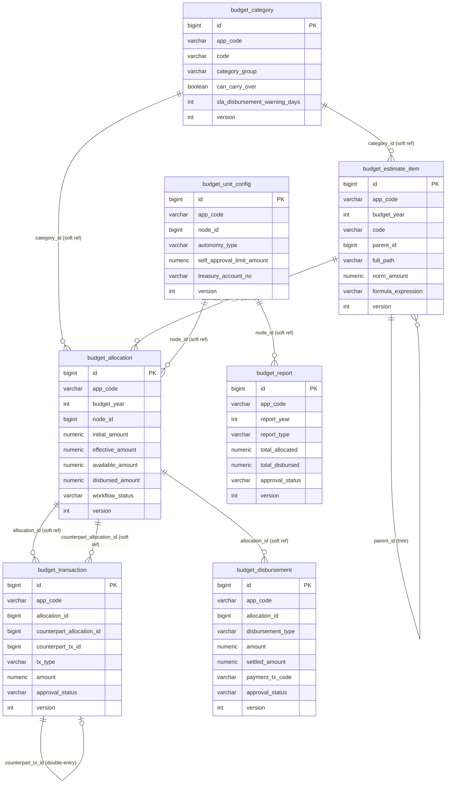

# Đánh giá Cơ sở Dữ liệu, JPA Entities & Flyway Migrations (`tr-budget-service`)

> **Phạm vi kiểm toán**: 7 JPA Entities (`dao/model/*.java`), 7 Repositories (`dao/service/*Repo.java`), `BaseEntity`/`BaseCommonEntity` (`tr-common-jpa`), 3 kịch bản Flyway (`V303_001`..`V303_003`), cấu hình `pom.xml`, `application.yml`, `_base`/`dev`/`ict-dng` và chiến lược khóa số dư / cách ly đa ứng dụng (`app_code`).
>
> **Ngày kiểm toán**: 2026-11-26 | **Chế độ**: Chỉ đọc & Đánh giá (không sửa mã nguồn).

## 1. Tổng quan Điểm số & Nhận định

| Tiêu chí | Điểm (`/10`) | Nhận định nhanh |
| --- | --- | --- |
| Cơ chế Migration (Flyway + Spring Boot 4) | 2.0 / 10 | `pom.xml` thiếu `spring-boot-starter-flyway`, YAML tắt `flyway.enabled=false` và bật `ddl-auto=update` -> toàn bộ file Flyway đang "chết", không tự chạy ở Spring Boot 4. |
| Đồng bộ Schema Entity ↔ Flyway | 3.5 / 10 | Lệch hàng loạt: `NUMERIC(18,2)` vs `NUMERIC(19,2)`, `VARCHAR(255)` vs `500`, 15 cột thừa ở SQL không có trong Entity, 22+ cột lệch `NOT NULL` -> sẽ crash ngay nếu bật `ddl-auto=validate`. |
| Ràng buộc Toàn vẹn, Khóa Số dư & Outbox | 4.0 / 10 | Có `@Version` (Integer) và `findByIdForUpdate`, nhưng 0 `FOREIGN KEY`, 0 `CHECK` constraint (`amount > 0`, `available_amount >= 0`), thiếu `sys_outbox_event` và bảng idempotency. |
| Chỉ mục, Multi-Tenancy (`app_code`) & JPQL | 6.0 / 10 | Có partial unique index `WHERE deleted_at IS NULL` và Hibernate `appCodeFilter` tốt; nhưng thiếu 4 index vận hành nóng và cả 7 Repo dính lỗi JPQL trên `softDeleteByIds` & `findAllByCodeIgnoreCaseIncludingDeletedSorted`. |
| Idempotency Script Migration trên DB cũ | 6.0 / 10 | `V303_001`..`V303_003` dùng `CREATE TABLE IF NOT EXISTS`, `ALTER TABLE ... ADD COLUMN IF NOT EXISTS`, `DROP COLUMN IF EXISTS` khá cẩn thận; nhưng vì Flyway không chạy nên chưa từng được kiểm chứng tự động qua CI. |
| **Tổng điểm Cơ sở Dữ liệu** | **4.3 / 10** | **Nghiêm trọng ở việc Flyway vô hiệu hóa trên Spring Boot 4, schema drift lớn và thiếu ràng buộc toàn vẹn tầng CSDL cho dữ liệu tiền tệ.** |

## 2. Mô hình Dữ liệu Quan hệ (7 Bảng Nghiệp vụ)

> Lưu ý: Mọi mối quan hệ trên đều là **tham chiếu mềm (soft reference)** bằng cột `BIGINT` kèm cột snapshot (`*_code`, `*_name`), **không có** bất kỳ ràng buộc `FOREIGN KEY` nào ở PostgreSQL.

## 3. Lỗi Flyway Vô hiệu trên Spring Boot 4 & Schema Drift Nghiêm trọng

### 3.1 Flyway Hoàn toàn Không Chạy (`DB-C01`)

- **Thiếu Starter cho Spring Boot 4**: `pom.xml:29-137` không khai báo `org.springframework.boot:spring-boot-starter-flyway` (root `pom.xml:120` mới khai báo trong `<dependencyManagement>`, còn `tr-common-jpa/pom.xml:47-52` chỉ kéo `flyway-core` và `flyway-database-postgresql`). Trong kiến trúc auto-configuration mô-đun hóa của Spring Boot 4.x, thiếu `spring-boot-starter-flyway` đồng nghĩa **không có `FlywayAutoConfiguration`**, nên `V303_001`..`V303_003` sẽ **không bao giờ tự thực thi**.
- **Tắt Flyway & Bật `ddl-auto=update` khắp nơi**:
  - `src/main/resources/application.yml:69,77`: `ddl-auto: ${JPA_DDL_AUTO:update}` và `spring.flyway.enabled: ${FLYWAY_ENABLED:false}`.
  - `config/_base/tr-budget-service.yml:57`, `config/dev/tr-budget-service-dev.yml:26`, `config/ict-dng/tr-budget-service-ict-dng.yml:24`: đều dùng `ddl-auto: update`.
  - `tr-budget-service.sh:161,188`: ép cứng `-DJPA_DDL_AUTO=update`.

### 3.2 Chi tiết Sai lệch Schema Entity ↔ Flyway (`DB-C02`)

Nếu bật `spring.jpa.hibernate.ddl-auto=validate` sau khi chạy `V303_001`..`V303_003`, ứng dụng sẽ **lỗi khởi động ngay lập tức** do 4 nhóm sai lệch lớn:

| Nhóm sai lệch | Flyway (`V303_001`..`V303_003`) | JPA Entities (`dao/model/*.java`) | Mức ảnh hưởng |
| --- | --- | --- | --- |
| **Độ chính xác tiền tệ (40+ cột)** | `NUMERIC(18, 2)` (`V303_001:110,166,253-266,356-363,500-502,593-607`) | `@Column(precision = 19, scale = 2)` ở cả 7 Entities | Lệch precision `18` vs `19`; vượt giới hạn khi tổng hợp NSNN cấp tỉnh/ngành hàng trăm nghìn tỷ nếu về sau cần mở rộng. |
| **Độ dài chuỗi `VARCHAR`** | `VARCHAR(255)` cho `parent_name`, `node_name`, `estimate_item_name`, `allocation_name`, `linked_plan_name`, `counterpart_allocation_name`, `counterpart_node_name`; `VARCHAR(100)` cho `decision_no`, `contract_no`, `voucher_no`, `treasury_ref_code`; `VARCHAR(100)` cho `unit_of_measure` | `length = 500`, `length = 150`, `length = 50` tương ứng trong Entity | Lỗi cắt chuỗi (`DataIntegrityViolationException`) trên DB sinh từ Flyway khi tên kế hoạch/phân bổ dài > 255 ký tự. |
| **15 Cột "mồ côi" (còn ở SQL sau `V303_002`, không có trong Entity)** | `budget_disbursement` (12 cột: `payment_method`, `retention_amount`, `advance_recovery_amount`, `beneficiary_type`, `beneficiary_bank_code`, `contract_id`, `invoice_symbol`, `treasury_form_code`, `treasury_status`, `linked_asset_id`, `linked_asset_code`, `is_overdue_warning_sent`); `budget_unit_config` (2 cột: `treasury_agency_code`, `treasury_deposit_account_no`); `budget_allocation` (1 cột: `funding_source_id`) | Không tồn tại field tương ứng trong Entity (đặc biệt làm mất cờ `is_overdue_warning_sent` của SLA job!) | Dữ liệu không thể đọc/ghi qua JPA; gây hiểu nhầm schema. |
| **22+ Cột lệch `NOT NULL`** | `NOT NULL` trên `category_group`, `autonomy_type`, `node_id`, `budget_year`, `initial_amount`, `allocation_id`, `disbursement_type`, `tx_type`, `tx_date`, `report_date`... | Mặc định `nullable = true` trên `@Column` | Lệch hợp đồng validation giữa JPA và PostgreSQL. |

> **Xác nhận kiểu dữ liệu tiền tệ**: Không có cột `DOUBLE PRECISION` / `FLOAT` nào được dùng cho số tiền trong cả 7 Entities và 3 file Flyway (đều là `BigDecimal` / `NUMERIC`). Tuy nhiên vẫn cần đồng nhất `NUMERIC(19, 2)` giữa Entity và Flyway.

## 4. Tính Toàn vẹn, Multi-Tenancy, Outbox & Khóa Số dư

### 4.1 Thiếu Ràng buộc Toàn vẹn & Bảng Hạ tầng (`DB-C03`)

1. **0 `FOREIGN KEY` và 0 `CHECK` constraint**: CSDL không có rào chắn cuối cùng ngăn `amount <= 0`, `available_amount < 0`, `disbursed_amount < 0`, `budget_year < 2000`, hay `allocation_id` trỏ tới bản ghi không tồn tại. Khi lỗi Race Condition (`BE-C01`) xảy ra ở tầng ứng dụng, PostgreSQL vẫn cho phép ghi `available_amount = -60000000.00`!
2. **Không có bảng `sys_outbox_event`**: Không thể triển khai Transactional Outbox Pattern cho Kafka (`domain-fact-metrics`) hoặc đồng bộ bất đồng bộ sang `tr-planning-service` / `tr-payment-service`.
3. **Không có bảng `budget_processed_event`**: Consumer Kafka (`BudgetPaymentEventListener`) và Webhook (`settleFromPaymentWebhook`) không có bảng lưu `event_id` / `transaction_code` đã xử lý để đảm bảo idempotency bền vững.
4. **Thiếu `jv_*` (JaVers) và hàm `unaccent`/`vn_unaccent` trong Flyway**: Hiện phụ thuộc cơ chế tự sinh lúc runtime (rủi ro khi chuyển tài khoản DB production sang quyền tối thiểu không có `CREATE TABLE` / `CREATE EXTENSION`).

### 4.2 Khóa Số dư (Optimistic & Pessimistic Locking)

- **Optimistic Lock**: Kế thừa `@Version private Integer version = 0` từ `BaseEntity.java:55-58`. Tuy nhiên các DTO không bắt buộc client gửi `version` khi `update()`, làm giảm hiệu quả phát hiện Lost Update từ phía người dùng.
- **Pessimistic Lock**: `BudgetAllocationRepo` đã khai báo `@Lock(LockModeType.PESSIMISTIC_WRITE) findByIdForUpdate(Long id)`, nhưng như phân tích tại `BE-C01`, hàm khóa chỉ được gọi **sau khi** đã kiểm tra số dư và `save()` chứng từ, nên không ngăn được double-spend.

### 4.3 Multi-Tenancy (`app_code`), Partial Unique Index & Lỗi JPQL

- **Điểm tốt**:
  - Cả 7 Entities đều gắn `@Filter(name = "appCodeFilter", condition = "app_code = :appCode")`, `@SQLRestriction("deleted_at IS NULL")` và `@EntityListeners(AppIsolatedListener.class)` bảo vệ cách ly theo `app_code`.
  - Đã tạo Partial Unique Index `WHERE deleted_at IS NULL` cho `(app_code, code)` trên 6 bảng, `(app_code, COALESCE(budget_year, 0), code)` trên `budget_estimate_item` (`V303_003:8-10`) và `uk_budget_unit_config_node_id` (`V303_002:82-84`), cho phép tái sử dụng mã sau khi xóa mềm.
- **Lỗi nghiêm trọng trên cả 7 Repositories (`DB-H01`)**:
  1. `findAllByCodeIgnoreCaseIncludingDeletedSorted` (`*Repo.java:33-37`): Viết bằng JPQL `WHERE a.code = :code` — vừa **phân biệt hoa thường** (thiếu `LOWER()`), vừa **bị `@SQLRestriction("deleted_at IS NULL")` tự động chèn thêm** nên không bao giờ tìm thấy bản ghi đã xóa mềm!
  2. `softDeleteByIds` (`*Repo.java:37-42`): Bulk JPQL `UPDATE ... SET a.deletedAt = :now WHERE a.id IN :ids` **không có `AND a.appCode = :appCode`** (Hibernate `@Filter` KHÔNG áp dụng cho câu lệnh bulk JPQL `UPDATE`/`DELETE`!).
  3. Native `findByIdIncludingDeleted(Long id)` không lọc `app_code` vẫn tồn tại song song trên cả 7 Repo.
- **Thiếu 4 Index Vận hành Quan trọng (`DB-H02`)**:
  - `budget_disbursement(app_code, payment_tx_code)` — phục vụ tra cứu từ Kafka `payment-events`.
  - `budget_disbursement(app_code, pay_transaction_id)` — phục vụ đối soát `tr-payment-service`.
  - `budget_transaction(app_code, counterpart_tx_id)` — phục vụ kiểm tra/đảo bút toán kép.
  - `budget_allocation(app_code, budget_year, node_id, estimate_item_id)` — phục vụ tìm kiếm nhanh phân bổ theo đơn vị và khoản mục năm.

## 5. Danh mục Phát hiện CSDL & Xếp hạng Mức độ

| Mã lỗi | Mức độ | Vị trí (`file:line`) | Mô tả vấn đề | Khuyến nghị khắc phục |
| --- | --- | --- | --- | --- |
| `DB-C01` | **CRITICAL** | `pom.xml:29-137`; `application.yml:69,77`; `config/_base/tr-budget-service.yml:57`; `tr-budget-service.sh:161` | Thiếu `spring-boot-starter-flyway` (Spring Boot 4), tắt `flyway.enabled=false` và bật `ddl-auto=update` -> Flyway không chạy trên mọi môi trường. | Thêm `spring-boot-starter-flyway`, bật `spring.flyway.enabled=true` (kèm `baseline-on-migrate=true` cho DB sẵn có) và chuyển `ddl-auto=validate` cho `dev`/`ict-dng`/`prod`. |
| `DB-C02` | **CRITICAL** | `V303_001__baseline_and_redesign_budget_schema.sql`; `V303_002`; 7 Entities (`dao/model/*.java`) | Lệch schema nghiêm trọng (`NUMERIC(18,2)` vs `19,2`, `VARCHAR(255)` vs `500`, 15 cột thừa, 22+ cột lệch `NOT NULL`) sẽ làm ứng dụng crash với `ddl-auto=validate`. | Tạo migration `V303_004` chuẩn hóa kiểu `NUMERIC(19,2)`, độ dài `VARCHAR`, quyết định map lại (`is_overdue_warning_sent`) hoặc dọn cột thừa, đồng bộ `nullable` và test tự động với PostgreSQL Testcontainers. |
| `DB-C03` | **CRITICAL** | `V303_001`..`V303_003` | 0 `FOREIGN KEY`, 0 `CHECK` constraint cho số tiền/số dư, thiếu `sys_outbox_event` và `budget_processed_event`, thiếu `jv_*` & `unaccent` trong migration. | Bổ sung `CHECK (amount >= 0)` / `CHECK (available_amount >= 0)` (kèm chính sách khóa dòng), bổ sung FK nội bộ hoặc trigger toàn vẹn, tạo bảng `sys_outbox_event` và `budget_processed_event` trong `V303_004`. |
| `DB-H01` | **HIGH** | 7 `*Repo.java:33-42` | Bulk JPQL `softDeleteByIds` bỏ qua `app_code` (rủi ro xóa chéo tenant); `findAllByCodeIgnoreCaseIncludingDeletedSorted` phân biệt hoa thường và bị `@SQLRestriction` lọc mất dòng đã xóa mềm. | Bổ sung `AND a.appCode = :appCode` cho `softDeleteByIds`, chuyển truy vấn restore sang native SQL với `LOWER(code) = LOWER(:code) AND app_code = :appCode` và loại bỏ `findByIdIncludingDeleted` không lọc `app_code`. |
| `DB-H02` | **HIGH** | `V303_001`..`V303_003` | Thiếu index cho `payment_tx_code`, `pay_transaction_id`, `counterpart_tx_id` và composite `(app_code, budget_year, node_id, estimate_item_id)`. | Bổ sung các index vận hành (ưu tiên partial index `WHERE deleted_at IS NULL`) trong migration `V303_004`. |
