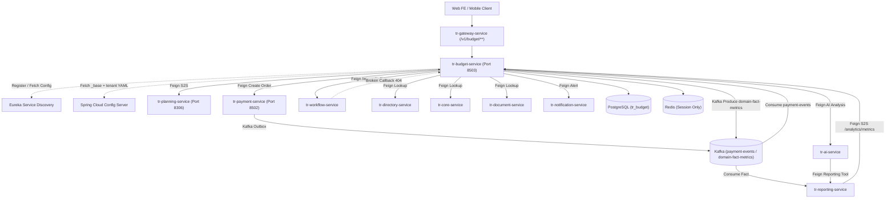

# Bản đồ Phụ thuộc (`pom.xml`, `tr-common-*`, Feign, Kafka, Redis & Call Graph)

> **Phạm vi kiểm toán**: Phân tích đầy đủ cây phụ thuộc Maven (`pom.xml`), mức độ sử dụng thực tế các module `tr-common-*`, danh sách Feign Clients đi/đến, Kafka Topics & Consumer Groups, Redis Keys, và đồ thị gọi chéo toàn hệ sinh thái `tr-pro-app` xoay quanh `tr-budget-service`.
>
> **Ngày kiểm toán**: 2026-11-26 | **Chế độ**: Chỉ đọc & Đánh giá (không sửa mã nguồn).

## 1. Tổng quan Điểm số & Nhận định

| Tiêu chí | Điểm (`/10`) | Nhận định nhanh |
| --- | --- | --- |
| Quản trị phụ thuộc Maven (`pom.xml`) | 5.0 / 10 | Tận dụng tốt BOM `tr-pro-app`, không có vòng lặp giữa các service; nhưng thiếu `spring-boot-starter-flyway` và `resilience4j`, `hibernate-processor` ở scope `compile` lọt vào fat JAR, thiếu version `central-publishing-maven-plugin`. |
| Hiệu quả sử dụng `tr-common-*` | 6.0 / 10 | Sử dụng tốt `core`, `jpa`, `web`, `security`, `satoken`, `feign`, `kafka`, `excel`, `doc`, `log`; nhưng nạp thừa 3 module (`redis`, `encrypt`, `ratelimiter`) không có annotation ứng dụng nào trong mã nguồn. |
| Hợp đồng Feign, Kafka & Redis | 5.5 / 10 | Phân rã topic Kafka rõ ràng (`payment-events`, `domain-fact-metrics`), không có vòng phụ thuộc chết; nhưng lệch tên service Eureka theo tenant và xung đột cấu hình deserializer. |
| **Tổng điểm Quản trị Phụ thuộc** | **5.5 / 10** | **Cấu trúc module nền tảng khá gọn, cần dọn phụ thuộc thừa/sai scope và bổ sung 2 starter thiết yếu (Flyway, Resilience4j).** |

## 2. Phân tích Phụ thuộc `pom.xml` & `tr-common-*`

### 2.1 Ma trận 13 Module `tr-common-*` Đang Khai báo (`pom.xml:31-83`)

| # | Module `tr-common-*` | Mức độ sử dụng thực tế | Ghi chú kiểm toán |
| --- | --- | --- | --- |
| 1 | `tr-common-core` | **Đang dùng mạnh** | `R<T>`, `PagedData`, `RefData`, `HeaderContext`, `ServiceException`, `UnifiedIdentityResolver`. |
| 2 | `tr-common-jpa` | **Đang dùng mạnh** | `BaseEntity`, `BaseCommonEntity`, `GenericServiceImpl`, `AppIsolatedListener`, `GlobalAuditController` (JaVers), `CriteriaBuilderHelper`. |
| 3 | `tr-common-web` | **Đang dùng mạnh** | `BaseController`, `AbstractWorkflowBusiness`, `GlobalWorkflowController`, `LookupOptionsHelper`. |
| 4 | `tr-common-security` | **Đang dùng một phần** | Dùng `SecurityConfig` (`SaInterceptor`, `SaServletFilter`); **chưa dùng** `OrgSubtreeAuthorizationHelper`. |
| 5 | `tr-common-satoken` | **Đang dùng mạnh** | `@SaCheckPermission`, `StpUtil`, `SaSameUtil`, `LoginHelper`; **chưa dùng** `@SaSharedLookup`. |
| 6 | `tr-common-feign` | **Đang dùng mạnh** | 8 Feign Clients đi + cung cấp `BudgetInternalClient` cho peer services. |
| 7 | `tr-common-kafka` | **Đang dùng một phần** | Dùng `KafkaConfig` (`StringDeserializer` + DLT) & `KafkaTemplate`; **chưa dùng** `OutboxPublisher` / `sys_outbox_event`. |
| 8 | `tr-common-excel` | **Đang dùng** | `GlobalExcelService` (có `FormulaSanitizingWriteHandler`), 3 `*ExcelService`. |
| 9 | `tr-common-log` | **Đang dùng** | `@Log` cho audit hành động trên Controllers. |
| 10 | `tr-common-doc` | **Đang dùng** | SpringDoc OpenAPI / Swagger UI (`/v3/api-docs`). |
| 11 | `tr-common-redis` | **Gần như không dùng ở Business** | Chỉ phục vụ Sa-Token DAO gián tiếp; **0** `@Cacheable`, **0** `RedisUtils`, **0** `RLock`/`Redisson`. |
| 12 | `tr-common-encrypt` | **KHÔNG DÙNG (0 tham chiếu)** | Không có `@EncryptField` nào trong mã nguồn (`DEP-M01`). |
| 13 | `tr-common-ratelimiter` | **KHÔNG DÙNG (0 tham chiếu)** | Không có `@RateLimiter` nào trên 164 endpoints (`DEP-M01`). |

### 2.2 Vấn đề Build & Dependency trong `pom.xml`

- **Thiếu `spring-boot-starter-flyway` (`DEP-C01` / liên kết `DB-C01`)**: Bắt buộc phải bổ sung để kích hoạt `FlywayAutoConfiguration` trong Spring Boot 4.x.
- **Thiếu `spring-cloud-starter-circuitbreaker-resilience4j` (`DEP-H01` / liên kết `INT-H02`)**: Khiến toàn bộ block `resilience4j.circuitbreaker` trong `config/_base/tr-budget-service.yml:264-272` trở thành cấu hình chết.
- **`hibernate-processor` ở scope mặc định `compile` (`pom.xml:120-123`, `DEP-H02`)**: Annotation processor bị đóng gói vào `BOOT-INF/lib/` của fat JAR runtime thay vì chỉ nằm trong `annotationProcessorPaths` hoặc `provided`.
- **Thiếu `<version>` cho `central-publishing-maven-plugin` (`pom.xml:160-166`, `DEP-M02`)**: Gây cảnh báo Maven model warning mỗi lần build.
- **Kiểm thử chỉ có H2 (`pom.xml:113-117`)**: Chưa có `org.testcontainers:postgresql` / `junit-jupiter` để kiểm thử Flyway & khóa `FOR UPDATE` trên PostgreSQL thật.

## 3. Danh mục Feign Clients (Chiều Gọi Đi & Chiều Gọi Đến)

### 3.1 Outbound Feign Clients (Từ `tr-budget-service` gọi đi)

| Feign Client (`vn.tr.common.feign.*`) | Dịch vụ đích | Biến cấu hình tên dịch vụ | Mục đích sử dụng | Rủi ro ghi nhận |
| --- | --- | --- | --- | --- |
| `PlanInternalClient` | `tr-planning-service` | `tr.feign.planning-service-name` | Đẩy số liệu phân bổ/giải ngân về Kế hoạch (`sync-budget-metrics`) | Gọi trong `@Transactional`, báo `synced=true` giả khi lỗi |
| `PaymentClient` | `tr-payment-service` | `tr.feign.payment-service-name` | Tạo lệnh thanh toán/chuyển khoản (`createPaymentOrder`) | Gọi trong `@Transactional`, hardcode `appCode="budget"`, bịa mã `PAY-KBNN-*` khi lỗi |
| `WorkflowFeignClient` | `tr-workflow-service` | `tr.feign.workflow-service-name` | `startWorkflowInternal`, `executeActionInternal`, `withdrawInternal`, `getEntityStatusInternal` | Chỉ gọi cho `BudgetAllocation`; thiếu cho 3 thực thể còn lại |
| `DirectoryNodeClient` / `DirectoryPersonClient` / `CoreUserClient` / `UnifiedIdentityResolver` | `tr-directory-service` / `tr-core-service` | `tr.feign.directory-service-name`, `tr.feign.core-service-name` | Làm giàu thông tin đơn vị (`nodeName`), cán bộ (`personName`), tài khoản | Dùng chung 1 cờ `identityBackoffUntil`; N+1 trong `enrichData()` |
| `DocumentClient` | `tr-document-service` | `tr.feign.document-service-name` | Tra cứu thông tin văn bản quyết định (`decisionDocumentId`) | Chưa có cache metadata văn bản |
| `NotificationClient` | `tr-notification-service` | `tr.feign.notification-service-name` | Gửi thông báo duyệt chi và cảnh báo SLA giải ngân | Gọi trong SLA job không có distributed lock |
| `AiClient` | `tr-ai-service` | `tr.feign.ai-service-name` | Phân tích điều hành ngân sách trên Dashboard | Không có circuit breaker / backoff; nội suy prompt thô |

### 3.2 Inbound Feign Callers (Các dịch vụ khác gọi vào `tr-budget-service`)

| Dịch vụ gọi vào | Client / Vị trí | Endpoint `tr-budget-service` | Trạng thái bảo vệ S2S |
| --- | --- | --- | --- |
| `tr-planning-service` | `PlanIntegrationOrchestrator.java:646,693` -> `BudgetInternalClient` | `POST /internal/budget/allocations/sync-from-plan`, `POST /internal/budget/transactions/record`, `GET /internal/budget/allocations/by-plan/{planCode}` | **KHÔNG ĐƯỢC BẢO VỆ** bởi `SaSameUtil` do `@SaIgnore` (`SEC-C01`) |
| `tr-reporting-service` | `BudgetDataConnector.java:67` -> `BudgetInternalClient` | `GET /internal/budget/analytics/metrics` | **ĐÃ BẢO VỆ** (`SaSameUtil.checkCurrentRequestToken()` tại dòng 125) |
| `tr-payment-service` | *(Hiện 0 caller Feign — chỉ đẩy Kafka `payment-events`)* | `POST /internal/budget/disbursements/{id}/payment-webhook-settle` | **KHÔNG ĐƯỢC BẢO VỆ** + lệch hợp đồng DTO (`INT-C01`) |
| `tr-workflow-service` | `WebhookServiceTaskExecutor` | Gọi callback theo `getCallbackUrl()` | **LỖI 404** (4/4 path `/api/v1/budget/*/workflow-callback` không tồn tại) |

## 4. Kafka Topics & Redis Keys

### 4.1 Bản đồ Kafka Topics

| Topic | Vai trò của `tr-budget-service` | Consumer Group / Lớp xử lý | Payload & Bảo đảm giao nhận |
| --- | --- | --- | --- |
| `payment-events` | **Consumer** | `tr-budget-service-payment-group` (`BudgetPaymentEventListener.java`) | JSON `PaymentCompletedEvent` (qua `StringDeserializer` + DLT từ `tr-common-kafka`). Thiếu bảng `budget_processed_event`; `application.yml:181` tắt mặc định, `_base:188` bật. |
| `payment-events.DLT` | **Dead Letter Topic** (do `tr-common-kafka` quản lý) | Vận hành thủ công | Nhận message lỗi sau retry từ `DefaultErrorHandler`. |
| `domain-fact-metrics` | **Producer** | `BudgetFactMetricPublisher.java` (đọc bởi `tr-reporting-service`) | Phát sau `TransactionSynchronization.afterCommit()` nhưng **không qua Outbox** -> có thể mất dữ liệu khi Kafka broker sập. |

### 4.2 Bản đồ Redis Keys

| Tiền tố / Nhóm Key | Nguồn quản lý | Trạng thái thực tế ở `tr-budget-service` |
| --- | --- | --- |
| `Authorization:login:*` / `satoken:*` | `tr-common-satoken` + `tr-common-redis` | Đang dùng để đọc phiên đăng nhập người dùng từ Redis dùng chung toàn hệ thống. |
| `satoken:var:same-token` | `SaSameUtil` | **Bị tắt kiểm tra Redis** tại `config/_base/tr-budget-service.yml:142` (`is-check-redis: false`) và `SA_TOKEN_SAME_SECRET` rỗng! |
| Cache nghiệp vụ (`budget:category:*`, `budget:unit-config:*`) | *(Chưa tồn tại)* | **0** key cache nghiệp vụ được tạo ra. |
| Khóa phân tán (`lock:budget:sla:*`) | *(Chưa tồn tại)* | **0** Redisson lock được dùng cho `@Scheduled` SLA job. |

## 5. Cross-Service Call Graph

## 6. Danh mục Phát hiện Phụ thuộc & Xếp hạng Mức độ

| Mã lỗi | Mức độ | Vị trí (`file:line`) | Mô tả vấn đề | Khuyến nghị khắc phục |
| --- | --- | --- | --- | --- |
| `DEP-C01` | **CRITICAL** | `pom.xml:29-137` | Thiếu `spring-boot-starter-flyway` khiến Flyway auto-configuration không kích hoạt trên Spring Boot 4.x. | Khai báo `org.springframework.boot:spring-boot-starter-flyway` trong `pom.xml`. |
| `DEP-H01` | **HIGH** | `pom.xml:29-137`; `config/_base/tr-budget-service.yml:264-272` | Thiếu `spring-cloud-starter-circuitbreaker-resilience4j` khiến cấu hình Resilience4j trong YAML vô hiệu hoàn toàn. | Bổ sung starter Resilience4j và gắn cho toàn bộ Feign Client gọi đi. |
| `DEP-H02` | **HIGH** | `pom.xml:120-123` | `org.hibernate.orm:hibernate-processor` khai báo scope mặc định `compile` nên bị đóng gói vào fat JAR production. | Chuyển sang `<scope>provided</scope>` hoặc cấu hình trong `maven-compiler-plugin` `annotationProcessorPaths`. |
| `DEP-M01` | **MEDIUM** | `pom.xml:65-67,77-79,45-47` | Kéo `tr-common-encrypt`, `tr-common-ratelimiter` (0 tham chiếu) và `tr-common-redis` (0 cache/lock nghiệp vụ) gây tăng kích thước JAR và diện tích cấu hình thừa. | Kích hoạt sử dụng thực tế (`@RateLimiter` cho export/batch/AI, `@EncryptField` cho tài khoản ngân hàng/MST, `@Cacheable` + `RLock` cho Redis) hoặc gỡ bỏ nếu chưa có nhu cầu. |
| `DEP-M02` | **MEDIUM** | `pom.xml:160-166`; `config/dev/tr-budget-service-dev.yml:83`; `config/{sct,sgtvt}/tr-workflow-service-*.yml:70` | Thiếu `<version>` trên `central-publishing-maven-plugin`; không nhất quán tên dịch vụ Eureka giữa `dev`/`sct`/`sgtvt` (`dev-reporting-service`, `sct-budget-service`, `sgtvt-budget-service`). | Khai báo version plugin ở parent/child POM và đồng nhất tên dịch vụ trên Config Server. |
