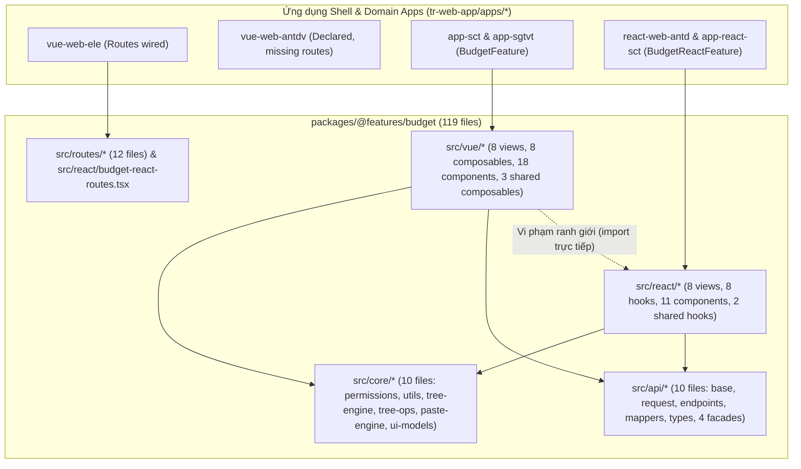

# Phân tích Frontend (`@tyran8x/feature-budget` — Vue 3 & React 19)

> **Phạm vi kiểm toán**: `tr-frontend/tr-web-app/packages/@features/budget/` (119 tệp được theo dõi trên Git), tích hợp vào các shell/domain apps trong `tr-web-app/apps/*` (`vue-web-ele`, `vue-web-antdv`, `react-web-antd`, `app-sct`, `app-sgtvt`, `app-react-sct`).
> **Lưu ý tuân thủ `LP-022`**: Không đánh giá hay chấm lỗi phân mảnh trên các kho tham khảo `sct-web-ui`, `sgtvt-web-ui` và không đề xuất xóa `apps/app-*`.
> **Điểm trưởng thành Frontend**: **5.8 / 10** *(Kiến trúc Headless Core + Dual-Framework mạnh, typecheck đạt 0 lỗi, nhưng tồn tại lỗ hổng fail-open RBAC, lệch hợp đồng API/enum với Backend, lỗi mất dữ liệu kéo-thả cây dự toán, hỏng parse tiền tệ Excel và thiếu xác nhận thao tác phá hủy)*.

---

## 1. Tổng quan Kiến trúc & Tích hợp Đa ứng dụng

Gói `@tyran8x/feature-budget` (`package.json:2`, version `1.0.15`) được thiết kế theo mô hình **Headless Feature Package** trong monorepo `tr-web-app`, tách biệt lớp dữ liệu & thuật toán thuần TypeScript khỏi hai lớp giao diện **Vue 3 + Element Plus** và **React 19 + Ant Design**:

### 1.1. Hiện trạng Tích hợp vào các Apps Monorepo

| Ứng dụng | Cách tích hợp `@tyran8x/feature-budget` | Trạng thái | Dẫn chứng |
| --- | --- | --- | --- |
| `apps/vue-web-ele` | Re-export `budgetRoutes` trong router module | Hoạt động đầy đủ (8 màn hình) | `apps/vue-web-ele/src/router/routes/modules/budget/index.ts:1` |
| `apps/app-sct` | Đăng ký `BudgetFeature` trong `main.ts` | Hoạt động đầy đủ | `apps/app-sct/src/main.ts:9` |
| `apps/app-sgtvt` | Đăng ký `BudgetFeature` trong `main.ts` | Hoạt động đầy đủ | `apps/app-sgtvt/src/main.ts:6` |
| `apps/react-web-antd` | Lazy map 8 view key `modules/budget/*` trong `helper.ts` | Hoạt động đầy đủ | `apps/react-web-antd/src/router/routes/helper.ts:266-273` |
| `apps/app-react-sct` | Đăng ký `BudgetReactFeature` trong `main.tsx` | Hoạt động đầy đủ | `apps/app-react-sct/src/main.tsx:4` |
| `apps/vue-web-antdv` | Khai báo dependency `workspace:*` và `tsconfig.json`, nhưng **không có route module** trong `src/` | Khai báo thừa / chưa nối tuyến | `apps/vue-web-antdv/package.json:48`, `git grep budget apps/vue-web-antdv/src` = 0 kết quả |

### 1.2. Vi phạm Ranh giới Kiến trúc & Cấu hình Tenant

1. **Vue import ngược mã từ thư mục React (`FE-M01`)**:
   - `src/vue/views/use-budget-ledger-transaction.ts:12-15` và `src/vue/components/BudgetLedgerAuxModals.vue:17` import trực tiếp `AUX_MODE_META`, `AuxOperationMode`, `getDefaultAuxForm` từ `../../react/views/budget-ledger-constants`.
   - Trong khi đó, `src/core/ledger-constants.ts` đã chứa một bản sao `AUX_MODE_META` cũ nhưng bị bỏ hoang (không được Vue lẫn React sử dụng) — vi phạm nguyên tắc DRY và phá vỡ ranh giới tách rời `src/vue` ↔ `src/react`.
2. **React entry kéo phụ thuộc Vue locales (`FE-M02`)**:
   - `src/react/feature.ts:1` import `../locales`, tệp này lại kéo gói `@tyran8x/vue-locales` (`src/locales.ts`), khiến bundle React thuần vẫn phụ thuộc transitive vào runtime i18n của Vue.
3. **Lệch `defaultTenant` trong cấu hình Tenant (`FE-M03`)**:
   - `src/tenant/index.ts:10` đặt `defaultTenant: 'sys'`, mâu thuẫn với `src/feature.ts:17` (`appCode: 'budget'`) và cấu hình Backend `config/_base/tr-budget-service.yml:184` (`app-code: budget`).
4. **Thư viện chết trong `package.json` (`FE-L01`)**:
   - `package.json:69,73,79` khai báo `zod`, `@vee-validate/zod` và `echarts`, nhưng kết quả quét `git grep` xác nhận **0 lượt import** cho cả 3 thư viện trong toàn bộ gói `@features/budget`.

---

## 2. Kiểm toán Động cơ Lõi (`src/core/*`)

### 2.1. Cây Dự toán (`estimate-tree-ops.ts` & `estimate-tree-engine.ts`)

| Thành phần | Chức năng hiện có | Lỗi & Rủi ro đã xác minh | Mức độ |
| --- | --- | --- | --- |
| `moveEstimateTreeNode` (`src/core/estimate-tree-ops.ts:173-209`) | Kéo-thả sắp xếp lại nút trên cây dự toán (`before`, `after`, `inner`) | Chỉ kiểm tra `isEstimateTreeDescendant(draggedNode, targetId)` khi `dropType === 'inner'` (`L176-178`). Khi người dùng kéo một nút cha thả ở vị trí `before` hoặc `after` một nút con/cháu của chính nó, hàm tách nút cha (kéo theo luôn nút đích) rồi gọi `insertRelative` không tìm thấy đích → **xóa vĩnh viễn toàn bộ nhánh cây đang kéo** mà không báo lỗi | **CRITICAL (`FE-C01`)** |
| `validateBudgetFormulaDsl` (`src/core/estimate-tree-engine.ts:70-126`) | Kiểm tra cú pháp công thức DSL (`SUM(CHILDREN)`, `[MA_MUC]`, biến chuẩn) | Chỉ phát hiện tự tham chiếu trực tiếp (`A -> A`), **không phát hiện vòng lặp nhiều bước** (`A -> B -> A`), và **không kiểm tra mã `[CODE]` có tồn tại** trên cây hay không | **MEDIUM (`FE-M04`)** |
| `computeEstimateTreeStats` (`src/core/estimate-tree-engine.ts:252-263`) | Tự động cộng dồn định mức từ nút lá lên nút cha và kiểm tra sức khỏe cây | Bỏ qua hoàn toàn `formulaExpression` của nút cha — luôn tính `SUM(CHILDREN)` ngay cả khi người dùng cấu hình `AVG(CHILDREN)` hay `HEADCOUNT * BASE_SALARY * 12`. Mảng số La Mã `ROMANS` (`L68`) chỉ có 12 phần tử (`I..XII`), nhóm mục cấp 1 thứ 13 trở đi bị mất tiền tố La Mã | **MEDIUM (`FE-M05`)** |

### 2.2. Động cơ Paste Excel (`spreadsheet-paste-engine.ts`)

`parseNumericCellValue` (`src/core/spreadsheet-paste-engine.ts:79-91`) dùng biểu thức chính quy `/^\d{1,3}(\.\d{3})+(,\d+)?$/` để nhận diện định dạng số Việt Nam, gây ra **2 lỗi sai lệch số liệu tài chính nghiêm trọng (`FE-C02`)**:

1. **Nhân 10 lần số thập phân không có dấu chấm hàng nghìn**: Chuỗi `"1500,5"` (1.500,5 VNĐ hoặc 1.500,5 triệu) không khớp regex vì thiếu dấu `.`, rơi xuống nhánh `raw.replace(/,/g, '')` → biến thành **`15005` (tăng gấp 10 lần)**!
2. **Mất hoàn toàn số âm (bút toán điều chỉnh giảm)**: Chuỗi `"-1.500.000"` có dấu `-` ở đầu nên không khớp regex, giữ nguyên dấu `.`, gọi `Number("-1.500.000")` ra `NaN` và trả về **`0`**!

### 2.3. Độ chính xác Số tiền VNĐ & Optimistic Locking

- **Thiếu chính xác thập phân (`FE-M06`)**: Toàn bộ 7 DTO ở `src/api/types.ts` và hàm định dạng `formatBudgetVnd` (`src/core/utils.ts`) dùng kiểu IEEE 754 `number` kết hợp `Math.round()`, không có xử lý `BigInt` hoặc chuỗi `Decimal` khi đồng bộ với `BigDecimal(19,2)` từ Java. Với giá trị tỷ đồng có phần lẻ hoặc tổng hợp ngân sách cấp tỉnh (> 9×10^15 đồng ở chế độ xu), có nguy cơ mất độ chính xác làm tròn.
- **Thiếu trường `version` chống ghi đè (`FE-H01`)**: Tất cả 7 interface trong `src/api/types.ts` đều **bỏ sót trường `@Version` `version`** của Hibernate JPA và lớp gọi API không xử lý mã lỗi HTTP `409 Conflict`, dẫn đến nguy cơ "lost update" khi 2 kế toán cùng sửa 1 phương án phân bổ hoặc chứng từ giải ngân.

---

## 3. Lỗi Hợp đồng API, Sai lệch Payload & Bảo mật Phân quyền FE

### 3.1. Lỗ hổng Fail-Open RBAC & Nhấp nháy Quyền trên React (`FE-C03`)

- **Fail-open trong lõi kiểm tra quyền (`src/core/permissions.ts:146-174`)**:
  - Hàm `resolveBudgetAccessCodes` trả về `undefined` khi `!store || !Array.isArray(store.accessCodes)` hoặc khi `isAccessChecked === false && !accessToken && accessCodes.length === 0`.
  - Hàm `hasBudgetPermission` trả về **`true`** mỗi khi `accessCodes === null || accessCodes === undefined`. Cơ chế này nhằm giúp unit test Vitest chạy mà không cần mock store, nhưng ở **Pure Cookie Mode** (khi `accessToken` trên Pinia là rỗng vì dùng Cookie `_tr_sec_sid`) hoặc khi store khởi tạo chậm/lỗi, **toàn bộ nút Phê duyệt, Xóa, Giải ngân đều mở khóa (fail-open)**!
- **React async hydration flash & fail-open (`src/react/hooks/use-budget-access.ts:16-54`)**:
  - `storeAccessCodes` khởi tạo là `undefined` và nạp bất đồng bộ bằng `await import('@tyran8x/react-access')` trong `useEffect`.
  - Hệ quả: Ở khung hình render đầu tiên (first paint), toàn bộ nút nghiệp vụ nhạy cảm hiển thị ở trạng thái được phép; nếu dynamic import thất bại (bị nuốt im lặng tại `L40`), người dùng **vĩnh viễn có toàn quyền giao diện**.
- **Không sử dụng chỉ thị `v-access`**: Toàn bộ 8 màn hình Vue 3 đều dùng `v-if="can(...)"` qua `useBudgetAccess`, có **0 lượt sử dụng `v-access`** theo chuẩn `module-standard`.

### 3.2. Sai lệch Hợp đồng API & Mất dữ liệu Âm thầm (`FE-H02`..`FE-H06`)

| Mã lỗi | Tệp & Dòng | Hành vi hiện tại trên FE | Hợp đồng thực tế trên BE | Tác động |
| --- | --- | --- | --- | --- |
| `FE-H02` | `src/api/facade-disbursements-reports.ts:219-232,264,276`, `src/vue/views/use-budget-category-matrix.ts:52,212`, `src/react/views/use-budget-category-matrix.ts:236`, `BudgetCategoryModals.vue:58` | `getCategories` biến `autonomyType` (`AUTONOMOUS`) thành nhãn tiếng Việt `'NSNN Giao tự chủ (NĐ 130/NĐ 60)'` trong `fundSource`, sau đó `createCategory`/`updateCategory` gửi ngược chuỗi tiếng Việt đó vào `autonomyType`! Vue khởi tạo sẵn chuỗi tiếng Việt nên hỏng cả Tạo & Sửa; React hỏng khi Sửa. Modal Vue còn có giá trị `DEDICATED_FUND` không tồn tại trong enum `BudgetAutonomyType.java` (`BudgetDataInitializer.java:122` cũng tự seed chuỗi này). Ngoài ra, `L230-231` ánh xạ lệch `clauseCode` → `typeCode` và `itemCode` → `kindCode` | `BudgetCategoryData` định nghĩa `autonomyType` theo enum `BudgetAutonomyType` và 5 cấp Mục lục NSNN (`chapterCode`, `typeCode`, `clauseCode`, `itemCode`, `subItemCode`) | Sai lệch dữ liệu Mục lục NSNN & lưu nhãn tiếng Việt thay mã enum vào DB |
| `FE-H03` | `src/api/facade-disbursements-reports.ts:113-118` | `reserveCommitment()` gọi `POST /disbursements` thay vì endpoint cam kết chi chuyên biệt | `BudgetDisbursementController.java:230` cung cấp `POST /disbursements/reserve-commitment` | Bỏ qua logic liên kết `planCode`, tự sinh mã `CKC-*` và đặt trạng thái `COMMITTED` |
| `FE-H04` | `src/api/facade-disbursements-reports.ts:105-112`, `src/react/views/use-budget-disbursement.ts:153` | `updateDisbursement()` đẩy thẳng object giao diện (`title`, `paymentVoucherNo`, `disbursedAmount`, `unitNodeCode`) lên `PUT /disbursements/{id}` mà **không map sang tên trường BE** | `BudgetDisbursementData` yêu cầu `name`, `voucherNo`, `amount`, `nodeCode` | Mọi thao tác Sửa hồ sơ giải ngân trên React 19 đều bị mất/lệch trường hoặc lỗi validation |
| `FE-H05` | `src/api/facade-disbursements-reports.ts:285-312` | `createUnitConfig`/`updateUnitConfig` gửi trường không tồn tại `allowSelfApprove` và bỏ qua 7 trường quản trị quan trọng (`canSelfAllocate`, `canSelfTransfer`, `taxCode`, `treasuryAccountNo`, `treasuryBranchName`, `approverPersonId`, `chiefAccountantPersonId`) | `BudgetUnitConfigData` có đủ 7 trường trên, không có `allowSelfApprove` (bị Jackson bỏ qua do `FAIL_ON_UNKNOWN_PROPERTIES: false`) | Không thể cấu hình tài khoản Kho bạc KBNN và phân quyền tự phân bổ từ UI |
| `FE-H06` | `src/vue/views/use-budget-allocation-workspace.ts:216-235`, `src/api/facade-allocations.ts:167,295,318` | Dialog tạo phân bổ Vue thu thập `temporalRegime`, `agencyCode`, `targetType`, `targetCode`, `responsiblePersonName`, `approvedByPersonName`, `createdByOfficerName`, `lineageNote` nhưng **bỏ rơi hoàn toàn** khi gọi `createAllocation` (dù BE `BudgetAllocationData.java:154-178` có `agencyCode` và `temporalRegime`). Ngoài ra, `facade-allocations.ts:295,318` map `counterpartNodeName` vào `toUnitNodeCode` và gửi `approvalScope: 'UNIT_SELF' \| 'DIRECTORATE'` (lệch enum `BudgetApprovalScope.java`) | `BudgetAllocationData` & `BudgetTransactionData` | Dữ liệu người dùng nhập trên modal bị mất âm thầm sau khi bấm Lưu |

### 3.3. Lệch Mã Quyền giữa Nút Giao diện FE và Backend (`FE-H07`)

Chi tiết đầy đủ được đối chiếu trong [assignment-permission.md](assignment-permission.md); tóm tắt 4 điểm xung đột gây HTTP `403 Forbidden` trực tiếp trên UI:

1. **Đồng bộ Kế hoạch (`syncToPlan`)**: Vue (`use-budget-allocation-workspace.ts:367`) và React (`use-budget-allocation-workspace.ts:357`, `BudgetAllocationWorkspaceView.tsx:268`) kiểm tra `BudgetAllocationEdit`, nhưng BE `BudgetAllocationController.java:271` yêu cầu **`BudgetAllocationApprove`**.
2. **Xuất gói hồ sơ DVC KBNN (`exportKbnnDvcPackage`)**: Vue (`use-budget-disbursement.ts:218`, `BudgetDisbursementView.vue:192`) và React (`use-budget-disbursement.ts:228`, `BudgetDisbursementView.tsx:215`) kiểm tra `BudgetDisbursementExport`, nhưng BE `BudgetDisbursementController.java:253-256` yêu cầu **`BudgetDisbursementDetail OR BudgetDisbursementApprove`**.
3. **Tạm giữ / Khoanh dự toán (`DX-01 EARMARK_HOLD`)**: `src/react/views/budget-ledger-constants.ts:104` (dùng chung cho cả Vue) đặt quyền thực thi là `APPROVE` (`BudgetTransactionApprove`), nhưng BE `BudgetTransactionController.java:294` yêu cầu **`BudgetTransactionSubmit`**.
4. **Lưu ma trận phân bổ**: `BudgetAllocationTreeMatrixPanel.vue:123` chặn hàm `handleSaveMatrix` chỉ bằng `allocationCreate`, dù `canEditMatrix` (`L37`) và BE (`BudgetAllocationController.java:297`) cho phép `BudgetAllocationCreate OR BudgetAllocationEdit`.

---

## 4. Ma trận Đối chiếu 8 Màn hình: Vue 3 vs React 19

| # | Màn hình (Route) | Vue 3 (`src/vue/views/*`) | React 19 (`src/react/views/*`) | Khác biệt & Khiếm khuyết nổi bật |
| --- | --- | --- | --- | --- |
| 1 | Tổng quan Điều hành (`/budget/dashboard`) | `BudgetDashboardView.vue` + `BudgetDashboardAnalyticsPanel.vue` | `BudgetDashboardView.tsx` + `BudgetDashboardTabs.tsx` | Payload `executeSmartReallocation` khác nhau: Vue gửi `sourceUnitCode`/`targetUnitCode`/`suggestedTransferAmount`, React gửi `fromUnitCode`/`toUnitCode`/`transferAmount` (BE `BudgetTransactionBusiness.java:663,717` xử lý fallback được cả hai, nhưng không chuẩn hóa hợp đồng). Không vẽ biểu đồ ECharts thực tế dù khai báo dependency `echarts` |
| 2 | Phân bổ Dự toán (`/budget/allocations`) | `BudgetAllocationWorkspaceView.vue` + 6 panels/modals | `BudgetAllocationWorkspaceView.tsx` + 2 modals | **Bất đối xứng lớn**: Vue có `TemporalTargetTreeStatusBoard`, bảng ma trận cây phân bổ và `useBudgetPresets` (chứa dữ liệu mẫu cứng Đà Nẵng); nhưng `BudgetAllocationDetailPanel.vue:84-101` vẽ **4 bước BPMN tĩnh cứng**, bỏ qua `workflowTimelineSteps` từ API! Ngược lại, React (`BudgetAllocationWorkspaceView.tsx:294`) hiển thị đúng timeline động từ BE nhưng thiếu bảng trạng thái mục tiêu theo kỳ |
| 3 | Cây Dự toán Thu-Chi (`/budget/estimate-tree`) | `BudgetEstimateTreeView.vue` + `EstimateTreeBuilderPanel.vue` | `BudgetEstimateTreeView.tsx` + `EstimateTreeBuilderPanel.tsx` | Cả hai dùng chung `src/core/estimate-tree-ops.ts` nên cùng dính lỗi mất nhánh khi kéo-thả cha sang `before`/`after` con (`FE-C01`). Modal spreadsheet batch của Vue có `TrCurrencyInput` và nút "Dọn dòng lỗi", React chưa có |
| 4 | Sổ cái Bút toán Kép (`/budget/transactions`) | `BudgetLedgerTransactionView.vue` + `BudgetLedgerAuxModals.vue` | `BudgetLedgerTransactionView.tsx` + `BudgetLedgerModals.tsx` | **Thiếu trường nhập liệu cho 7/9 nghiệp vụ phụ (`FE-H08`)**: Cả Vue (`BudgetLedgerAuxModals.vue:121-162`) lẫn React (`BudgetLedgerModals.tsx:69-164`) chỉ có form riêng cho `SUPPLEMENT_CONTENT` và `CROSS_DOMAIN_TRANSFER`; 7 nghiệp vụ còn lại (`NV-02`, `NV-04`, `NV-05`, `DX-01`, `DX-02`, `DX-03`, `DX-04`) gửi giá trị mặc định `0` hoặc thiếu trường bắt buộc |
| 5 | Cam kết chi & Giải ngân (`/budget/disbursements`) | `BudgetDisbursementView.vue` + `BudgetDisbursementModals.vue` | `BudgetDisbursementView.tsx` + `BudgetDisbursementModals.tsx` | Vue có `TrBatchExecutionModal`, thiếu Sửa hồ sơ và thiếu pre-check `validateDisbursementRequest`; React có `openEditDisbursementModal` (nhưng lỗi không map field `FE-H04`), có modal `reserveCommitment` (nhưng gọi sai endpoint `FE-H03`) và có pre-check `validateDisbursementRequest` |
| 6 | Báo cáo Định kỳ (`/budget/reports`) | `BudgetPeriodicReportView.vue` + `BudgetPeriodicReportModals.vue` | `BudgetPeriodicReportView.tsx` + `BudgetPeriodicReportModals.tsx` | Cả hai chỉ lưu dòng điều chỉnh vào RAM (`handleSaveCustomAdjustmentRow`: "trên bảng tạm" → mất ngay khi F5), hardcode `periodType: 'SEMI_ANNUAL'` khi gọi `handleConsolidateLedger`, và hardcode 2 nút mốc ngày `'10-23'`/`'10-30'` (`BudgetPeriodicReportView.tsx:292-297`) |
| 7 | Mục lục NSNN & Ma trận (`/budget/categories`) | `BudgetCategoryMatrixView.vue` + `BudgetCategoryModals.vue` | `BudgetCategoryMatrixView.tsx` + `BudgetCategoryModals.tsx` | Cả hai dính lỗi chuyển ngược nhãn tiếng Việt vào `autonomyType` (`FE-H02`) và map lệch cột `Loại`/`Khoản` (`clauseCode`/`itemCode`) |
| 8 | Cấu hình Tự chủ Đơn vị (`/budget/unit-configs`) | `BudgetUnitConfigView.vue` | `BudgetUnitConfigView.tsx` | Cả hai thiếu 7 trường quản trị quan trọng của `BudgetUnitConfigData` và gửi nhầm `allowSelfApprove` (`FE-H05`) |

---

## 5. Đánh giá Chất lượng Kỹ thuật, UX An toàn Tài chính & Kiểm thử

### 5.1. Validation, An toàn Thao tác, Phân trang & Dữ liệu Mẫu Production

1. **0% Validation bằng Zod / `useTrForm` (`FE-H09`)**: Toàn bộ form tạo/sửa đều dùng kiểm tra thủ công `if (!form.code)` rải rác hoặc bỏ trống validation số âm/ngày hợp lệ.
2. **0% Hộp thoại Xác nhận Thao tác Phá hủy & Lý do Từ chối (`FE-H10`)**:
   - Không có bất kỳ `ElMessageBox.confirm`, `ElPopconfirm`, `Modal.confirm` hay `Popconfirm` nào trong toàn bộ 119 tệp nguồn. Nhấn nút **Xóa** lập tức gọi `DELETE` lên server; nhấn **Từ chối** trên Giải ngân, Bút toán, Báo cáo lập tức gửi chuỗi lý do viết sẵn mà không yêu cầu người dùng nhập lý do từ chối.
3. **Cắt cụt dữ liệu im lặng — Không có Phân trang Server (`FE-H11`)**:
   - `normalizePageContent` (`src/api/mappers.ts:1-11`) chỉ trích xuất `content` và **vứt bỏ hoàn toàn `totalElements`, `totalPages`**. Mọi màn hình danh sách tải cứng `{ page: 0, size: 50 | 100 | 200 }` với `pagination={false}`, gây mất hiển thị âm thầm khi dữ liệu vượt quá 50–200 bản ghi/năm.
4. **Rò rỉ Dữ liệu Demo cứng trong Mã Production (`FE-M07`)**:
   - `src/core/ledger-constants.ts:334-387` chứa sẵn dữ liệu mẫu `SGTVT`, `2_150_000_000`, `QĐ-1508/QĐ-UBND`.
   - `src/vue/composables/use-budget-presets.ts` chứa 4 kịch bản demo Đà Nẵng (tên đơn vị, họ tên cán bộ, MST mẫu) hiển thị trực tiếp trong `BudgetAllocationCreateDialog.vue:106-141`.
   - `TrCurrentOfficerField` hardcode chức danh `"Chuyên viên Phòng Kế hoạch - Tài chính"`.
5. **Xử lý Lỗi Bất đồng bộ & Tải Tệp chưa an toàn (`FE-M08`)**:
   - `src/react/components/BudgetDataToolsMenu.tsx:163-173` không có `try/catch` cho hành động xuất/tải mẫu Excel.
   - `src/vue/components/BudgetDataToolsDropdown.vue:78,86-89` đóng modal batch trước khi `submitBatchRows` hoàn tất và thiếu `.catch()` khi tải template.
6. **0% Đa ngôn ngữ (i18n) trong Views (`FE-M09`)**:
   - `src/locales/vi-VN/common.json` và `en-US/common.json` chỉ dài 74 dòng (tiêu đề route và 3 nhãn chung); 100% nhãn giao diện trong views/modals là chuỗi tiếng Việt viết cứng, 0 lượt dùng `useI18n`/`$t()`.
7. **Bảo mật XSS**: Kết quả kiểm tra xác nhận **0 lượt** dùng `v-html`, `dangerouslySetInnerHTML`, `innerHTML` hay `document.write` — **Đạt chuẩn tốt**.
8. **Kỹ thuật & Vệ sinh Mã nguồn (`FE-M10`)**:
   - Có **8 lượt dùng directive `v-loading`** trong các component Vue, vi phạm quy chuẩn tách adapter UI và gây ra **hơn 4.400 dòng cảnh báo `[Vue warn]: Failed to resolve directive: loading`** khi chạy test.
   - Có **4 tệp vượt ngưỡng 400 dòng** theo `development-rules`: `src/api/endpoints.ts` (507 LOC), `src/core/ui-models/types.ts` (465 LOC), `src/vue/views/use-budget-allocation-workspace.ts` (439 LOC), `src/react/views/use-budget-allocation-workspace.ts` (412 LOC).

### 5.2. Kết quả Kiểm chứng Thực thi Trực tiếp (Live Verification)

| Lệnh kiểm chứng | Kết quả | Chi tiết thực đo |
| --- | --- | --- |
| `pnpm --dir packages/@features/budget typecheck` (`vue-tsc --noEmit --skipLibCheck && tsc -p tsconfig.react.json --noEmit --skipLibCheck`) | **PASS (Exit 0)** | 0 lỗi TypeScript cho cả nhánh Vue 3 lẫn React 19 |
| `pnpm --dir packages/@features/budget test` (Vitest) | **PASS (4/4 files, 27/27 tests, 70.67s)** | `routes-contract.test.ts`, `budget-workflow.test.ts`, `estimate-tree-and-batch.test.ts`, `budget-ui-ux.spec.ts` đều xanh; **nhưng phát sinh > 4.400 dòng stderr** cảnh báo `[Vue warn]: Failed to resolve directive: loading` & `injection "Symbol(router)" not found` |
| React 19 Component Tests | **MISSING (0 tệp)** | Không có bất kỳ bài kiểm thử render/tương tác nào cho 8 màn hình React 19 |
| Playwright E2E Tests | **MISSING (0 tệp)** | Không có kịch bản E2E kiểm thử luồng Phân bổ → Phê duyệt → Giải ngân → Báo cáo trên trình duyệt |

---

## 6. Tổng hợp Phát hiện Frontend

| Mã | Mức độ | Tóm tắt phát hiện | Vị trí chính |
| --- | --- | --- | --- |
| `FE-C01` | CRITICAL | Kéo-thả nút cha vào `before`/`after` nút con làm mất vĩnh viễn toàn bộ nhánh cây | `src/core/estimate-tree-ops.ts:173-209` |
| `FE-C02` | CRITICAL | `parseNumericCellValue` nhân 10 lần số thập phân (`1500,5` → `15005`) và xóa số âm về `0` | `src/core/spreadsheet-paste-engine.ts:79-91` |
| `FE-C03` | CRITICAL | `hasBudgetPermission` fail-open (`undefined` → `true`); React nhấp nháy toàn quyền & fail-open khi import động lỗi | `src/core/permissions.ts:146-174`, `src/react/hooks/use-budget-access.ts:16-54` |
| `FE-H01` | HIGH | Toàn bộ 7 DTO bỏ sót `@Version` `version`, không xử lý HTTP `409 Conflict` | `src/api/types.ts` |
| `FE-H02` | HIGH | Lỗi đảo nhãn tiếng Việt vào `autonomyType`, giá trị ma `DEDICATED_FUND`, lệch cột `clauseCode`/`itemCode` | `src/api/facade-disbursements-reports.ts:219-276`, `BudgetCategoryModals.vue:58` |
| `FE-H03` | HIGH | `reserveCommitment()` gọi `POST /disbursements` thay vì `POST /disbursements/reserve-commitment` | `src/api/facade-disbursements-reports.ts:113-118` |
| `FE-H04` | HIGH | `updateDisbursement()` gửi thẳng UI fields không map sang BE fields (làm hỏng nút Sửa trên React) | `src/api/facade-disbursements-reports.ts:105-112`, `src/react/views/use-budget-disbursement.ts:153` |
| `FE-H05` | HIGH | `UnitConfig` gửi trường giả `allowSelfApprove` và bỏ rơi 7 trường quản trị/KBNN thực | `src/api/facade-disbursements-reports.ts:285-312` |
| `FE-H06` | HIGH | Dialog tạo phân bổ Vue làm rơi 8 trường người dùng nhập; `facade-allocations.ts` lệch `approvalScope` & `counterpartNodeName` | `src/vue/views/use-budget-allocation-workspace.ts:216-235`, `src/api/facade-allocations.ts:167,295` |
| `FE-H07` | HIGH | 4 điểm lệch quyền UI vs BE (`syncToPlan`, `kbnnDvcPackage`, `DX-01`, `saveMatrix`) gây HTTP 403 | `use-budget-allocation-workspace.ts:367`, `use-budget-disbursement.ts:218`, `budget-ledger-constants.ts:104` |
| `FE-H08` | HIGH | 7/9 nghiệp vụ điều chỉnh sổ cái thiếu trường form, gửi giá trị mặc định `0` | `BudgetLedgerAuxModals.vue:121-162`, `BudgetLedgerModals.tsx:69-164` |
| `FE-H09` | HIGH | 0% Zod / `useTrForm` validation trên toàn bộ form nghiệp vụ tài chính | `src/vue/**`, `src/react/**` |
| `FE-H10` | HIGH | 0% hộp thoại xác nhận trước khi Xóa và 0% ô nhập lý do khi Từ chối | Toàn bộ views Vue & React |
| `FE-H11` | HIGH | Cắt cụt im lặng ở 50–200 bản ghi (`normalizePageContent` bỏ `totalElements`, không có phân trang server) | `src/api/mappers.ts:1-11` |
| `FE-M01` | MEDIUM | Vue import ngược từ `src/react/views/budget-ledger-constants.ts`; bản sao `src/core/ledger-constants.ts` bị bỏ hoang | `src/vue/views/use-budget-ledger-transaction.ts:12-15` |
| `FE-M02` | MEDIUM | `src/react/feature.ts:1` kéo phụ thuộc `@tyran8x/vue-locales` | `src/react/feature.ts:1` |
| `FE-M03` | MEDIUM | `src/tenant/index.ts:10` đặt `defaultTenant: 'sys'` thay vì `'budget'`; `apps/vue-web-antdv` chưa nối route | `src/tenant/index.ts:10`, `apps/vue-web-antdv/package.json:48` |
| `FE-M04` | MEDIUM | Formula DSL không bắt vòng lặp nhiều bước (`A -> B -> A`) và mã chỉ tiêu không tồn tại | `src/core/estimate-tree-engine.ts:70-126` |
| `FE-M05` | MEDIUM | `computeEstimateTreeStats` bỏ qua `formulaExpression`; `ROMANS` dừng ở 12 | `src/core/estimate-tree-engine.ts:68,252-263` |
| `FE-M06` | MEDIUM | Dùng `number` + `Math.round()` cho tiền VNĐ thay vì cơ chế chính xác thập phân | `src/core/utils.ts`, `src/api/types.ts` |
| `FE-M07` | MEDIUM | Rò rỉ dữ liệu demo cứng (Đà Nẵng, SGTVT, `2.15 tỷ`, tên cán bộ) trong mã nguồn production | `src/vue/composables/use-budget-presets.ts`, `src/core/ledger-constants.ts:334-387` |
| `FE-M08` | MEDIUM | Thiếu `try/catch` tải Excel trên React; Vue đóng batch modal sớm trước khi API hoàn tất | `BudgetDataToolsMenu.tsx:163-173`, `BudgetDataToolsDropdown.vue:78-89` |
| `FE-M09` | MEDIUM | 0% i18n trong views/modals; 100% chuỗi tiếng Việt hardcode; dòng điều chỉnh báo cáo chỉ lưu RAM | `src/locales/*`, `use-budget-periodic-report.ts:169-194` |
| `FE-M10` | MEDIUM | 8 directive `v-loading` gây > 4.400 dòng Vue warn khi test; 4 tệp vượt 400 LOC; Vue BPMN timeline hardcode 4 bước tĩnh | `BudgetAllocationDetailPanel.vue:84-101`, `endpoints.ts` (507 LOC) |
| `FE-L01` | LOW | 3 thư viện chết trong `package.json` (`zod`, `@vee-validate/zod`, `echarts`); 0 React component test; 0 Playwright E2E | `package.json:69,73,79` |
