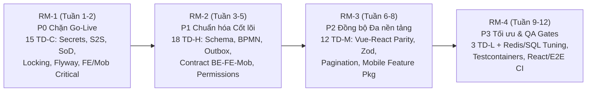

# Lộ trình Nâng cấp & Khắc phục Toàn diện (`RM-1`..`RM-4`)

> **Mục tiêu**: Đưa hệ thống Quản lý Ngân sách (`tr-budget-service` + `@tyran8x/feature-budget` Vue/React + Flutter `budget`) từ mức **5.01 / 10 (Chặn Go-Live)** lên **>= 8.5 / 10 (Production-Ready Chuẩn Tài chính Công)** trong 4 giai đoạn (12 tuần), bao phủ **100% 48 khoản nợ kỹ thuật (`TD-C01`..`TD-L03`)**.

---

## 1. Kiến trúc Lộ trình 4 Giai đoạn

| Giai đoạn | Thời lượng | Trọng tâm | Phạm vi `TD-*` giải quyết | Ước lượng Công (Man-days) | Điểm mục tiêu |
| --- | --- | --- | --- | --- | --- |
| **`RM-1`** | Tuần 1–2 | Vá toàn bộ lỗ hổng P0 Bảo mật, Tiền tệ, Khóa dữ liệu & Bug mất dữ liệu Client | Toàn bộ **15 CRITICAL** (`TD-C01`..`TD-C15`) | ~28 MD (BE 16, FE 7, Mobile 5) | **5.0 → 6.8 / 10** |
| **`RM-2`** | Tuần 3–5 | Chuẩn hóa CSDL/Flyway, BPMN, Outbox, Hợp đồng API, Phân quyền & Validation | Toàn bộ **18 HIGH** (`TD-H01`..`TD-H18`) | ~36 MD (BE 18, FE 11, Mobile 7) | **6.8 → 7.9 / 10** |
| **`RM-3`** | Tuần 6–8 | Đồng bộ Vue 3 ↔ React 19, Zod/i18n/Pagination, Chốt sổ NĐ 60, Tách Mobile Package | Toàn bộ **12 MEDIUM** (`TD-M01`..`TD-M12`) | ~26 MD (BE 8, FE 10, Mobile 8) | **7.9 → 8.5 / 10** |
| **`RM-4`** | Tuần 9–12 | Hiệu năng Redis/SQL, Observability, Testcontainers, React & Playwright E2E CI Gates | Toàn bộ **3 LOW** (`TD-L01`..`TD-L03`) + QA Gates | ~18 MD (BE 7, FE 7, Mobile 4) | **8.5 → 9.0+ / 10** |

---

## 2. Chi tiết Kế hoạch Từng Giai đoạn

### 2.1. `RM-1` — Vá Khẩn cấp P0 Chặn Go-Live (Tuần 1–2)

> **Nguyên tắc**: Tuyệt đối không triển khai môi trường thực tế khi chưa hoàn tất 100% các đầu mục `RM-1`.

| Nhóm việc | Mã `TD-*` | Hành động kỹ thuật cụ thể | Tiêu chí Nghiệm thu (Definition of Done) |
| --- | --- | --- | --- |
| **1. Secrets, CI/CD & S2S Hardening** | `TD-C01`, `TD-C02` | Thu hồi & xoay vòng ngay token Sonatype, Nexus, Telegram, mật khẩu DB/Redis; sửa `Jenkinsfile` về cổng `8503` + `Dockerfile` non-root + bật SSL; gỡ `@SaIgnore` cấp class trên `BudgetInternalController` (hoặc gọi `SaSameUtil.checkCurrentRequestToken()` cho cả 7/7 S2S endpoint); cấu hình `SA_TOKEN_SAME_SECRET` bắt buộc & `is-check-redis: true`; đổi `health.show-details: when_authorized` | Quét secret 0 phát hiện; gọi 6/7 endpoint `/internal/budget/**` không có `SAME-TOKEN` trả HTTP `401/403`; Jenkins deploy đúng container `tr-budget-service:8503` non-root |
| **2. Chống Giả mạo, SoD 4 Mắt & ABAC** | `TD-C03`, `TD-C04` | Sửa `BudgetIntegrationOrchestrator` cấm đọc `actorId`/`actorName` từ HTTP body; cưỡng chế SoD (`creator != reviewer != approver`) trên cả 4 thực thể workflow & tắt auto-approve 1 bước sổ cái; tiêm `OrgSubtreeAuthorizationHelper` vào mọi Business & Criteria Specification để chặn IDOR theo `nodeId` | Test xác minh user không thể tự duyệt hồ sơ mình tạo, không thể spoof `approvedByPersonId` trong JSON, và nhận `403` khi truy cập `nodeId` ngoài phạm vi đơn vị |
| **3. Khóa Số dư, Bất biến Sổ cái & Toán học NSNN** | `TD-C05`, `TD-C06`, `TD-C07` | Khóa `findByIdForUpdate` theo thứ tự ID tăng dần **trước** khi kiểm tra vượt dự toán ở cả `create()` & `approve()`; ép cứng `DRAFT` khi `create()`, khóa bất biến sửa/xóa/rollback chứng từ `APPROVED`/`SETTLED`, tách Request DTO chặn Mass Assignment; đồng nhất Enum (`EARMARK_RELEASE`, `PENDING_APPROVAL`, `UNIT_SELF_APPROVAL`, `SUPERIOR_APPROVAL`), chuyển sang whitelist trạng thái, sửa công thức `ADVANCE_SETTLEMENT`, bỏ `.abs()`, vá `NV-02`/`DX-03`/`DX-04`, đổi xuất gói DVC sang `POST` và bỏ TK kho bạc giả | Concurrency test 20 luồng giải ngân song song không bao giờ đẩy `availableAmount < 0` và không deadlock; toàn bộ NV-01..DX-04 qua Validator với 0 lỗi enum; `ADVANCE + ADVANCE_SETTLEMENT` không đếm trùng |
| **4. Kích hoạt Flyway & Toàn vẹn CSDL** | `TD-C09`, `TD-C10` | Thêm `spring-boot-starter-flyway` vào `pom.xml`; viết migration `V303_004` đồng nhất `NUMERIC(19,2)`, độ dài `VARCHAR`, cột thừa/thiếu (khôi phục `is_overdue_warning_sent`), `NOT NULL`, bổ sung `CHECK` constraint số dư/số tiền, tạo bảng `sys_outbox_event` & `budget_processed_event`; bật `flyway.enabled=true` & `ddl-auto=validate` | Khởi động dịch vụ trên PostgreSQL sạch qua Testcontainers với `ddl-auto=validate` thành công 100% không lỗi drift |
| **5. Sửa Webhook Payment & Callback BPMN** | `TD-C08`, `TD-C11` | Sửa 4/4 `getCallbackUrl()` về `/workflow/callback`, thêm BPMN `budget_report_approval`, nối `startWorkflowInternal` cho đủ 4 thực thể & xử lý `REWORK`; truyền typed `BudgetPaymentSettleData` kiểm tra `paymentStatus == PAID` & `paidAmount` kèm idempotency qua `budget_processed_event`; triển khai `OutboxPublisher` cho đồng bộ `tr-planning-service` & Kafka `domain-fact-metrics`, đưa mọi Feign call ra khỏi `@Transactional`, truyền đúng `HeaderContext.getAppCode()` | Flowable callback trả HTTP `200`; webhook thanh toán thất bại bị từ chối, gọi lặp lần 2 không nhân đôi thông báo; khi `tr-planning-service` tạm dừng, bản ghi lưu `sys_outbox_event` và tự retry thành công |
| **6. Vá 4 Bug Chí mạng trên Web FE & Mobile** | `TD-C12`, `TD-C13`, `TD-C14`, `TD-C15` | **FE**: Đổi `hasBudgetPermission` sang fail-closed (`false`), bỏ dynamic import async ở React; chặn `isEstimateTreeDescendant` cho cả `before`/`after`/`inner` trong `moveEstimateTreeNode`; viết lại `parseNumericCellValue` xử lý đúng `"1500,5"` và `"-1.500.000"`. **Mobile**: Tách `Future.wait(14)` theo quyền `canBudgetAction`, lazy-load từng tab kèm `runGuarded` chống sập toàn trang | Vitest pass test case kéo-thả cha sang `before`/`after` con (0 mất nút), paste `"1500,5"` = `1500.5` và `"-1.500.000"` = `-1500000`, Pure Cookie Mode không mở nút trái phép; Flutter test xác nhận user chỉ có 1 quyền vẫn mở được tab hợp lệ |

---

### 2.2. `RM-2` — Chuẩn hóa Cốt lõi BE, Hợp đồng API & Phân quyền Đa nền tảng (Tuần 3–5)

| Nhóm việc | Mã `TD-*` | Hành động kỹ thuật cụ thể | Tiêu chí Nghiệm thu |
| --- | --- | --- | --- |
| **1. Dọn Cấu hình Tenant, Seed & JVM** | `TD-H01`, `TD-H02`, `TD-H03` | Giới hạn `BudgetDataInitializer` bằng `@Profile({"local", "dev"})` + cờ tắt mặc định; bổ sung config cho `sct`, `sgtvt`, `stttt`, `uat`, `prod` và đồng nhất tên dịch vụ Eureka; sửa `tr-budget-service.sh` sang `G1GC`, `-Xmx1536m`, bỏ ép `ddl-auto=update`, dùng PID file theo profile | Profile `prod` khởi động không chạy seed; config đầy đủ cho toàn bộ tenant trên Config Server |
| **2. Bảo mật Multi-Tenant, Index & SLA Lock** | `TD-H04`, `TD-H05`, `TD-H07` | Sửa 7 `*Repo.java` thêm `app_code` vào `softDeleteByIds` & viết native `LOWER(code)` cho restore; đổi `BudgetQueryHelper.resolveCurrentAppCode()` sang fail-closed; thêm 4 partial index trong `V303_004`; bọc SLA job bằng Redisson `RLock` duyệt theo từng `appCode` với cờ `isOverdueWarningSent` & đọc `slaDisbursementWarningDays`; triển khai `BudgetStateMachine` | Cross-tenant bulk delete bị chặn hoàn toàn; chạy 2 replicas cùng lúc chỉ gửi đúng 1 cảnh báo SLA/hồ sơ quá hạn |
| **3. Sửa Nghiệp vụ Báo cáo, Formula & God Classes** | `TD-H06`, `TD-H12` | Sửa `BudgetReportBusiness` (`carryOverOut`, `expAdv`, bỏ `isSnapshotOct23`), vá `NV-03`/`NV-05`/`DX-02`, bổ sung `BudgetFiscalPeriod` chốt sổ niên độ Điều 64 Luật NSNN; hoàn thiện cycle detection gián tiếp & evaluator cho công thức DSL; phân rã `BudgetTransactionBusiness` (2.651 LOC) & `BudgetReportBusiness` (1.568 LOC) thành các helper/service chuyên trách `< 400 LOC` | Báo cáo đối chiếu KBNN khớp 100% số liệu sổ cái; không còn tệp Java Business nào vượt quá 600 LOC |
| **4. Resilience4j, Kafka & Typed `@Valid` APIs** | `TD-H08`, `TD-H09` | Thêm `spring-cloud-starter-circuitbreaker-resilience4j` + gắn `@CircuitBreaker` riêng từng peer client; đồng bộ cấu hình Kafka YAML (bỏ `trusted.packages: "*"`) & lọc tenant consumer; chuyển `hibernate-processor` sang `provided`; thay 40 endpoint `Map<String, Object>` bằng typed DTO gắn `@Valid`, hạ multipart xuống 15MB + giới hạn dòng import, thêm `@RateLimiter`, sanitize AI prompt | 100% endpoint nhận `@RequestBody` có `@Valid` và OpenAPI schema đầy đủ; lỗi input trả `400 Bad Request` thay vì `500 NumberFormatException` |
| **5. Đồng bộ 100% Quyền & Contract BE ↔ FE ↔ Mobile** | `TD-H10`, `TD-H13`, `TD-H14`, `TD-H15`, `TD-H16`, `TD-H17`, `TD-H18` | Sửa đủ 7 điểm lệch mã quyền (`syncToPlan`, `kbnnDvcPackage`, `DX-01`, 8 NV sổ cái Mobile, `saveMatrix` Vue, `budgetAny` thêm `BudgetDashboardQuery`, xóa 2 mã ma `*History`); sửa `resolveBudgetPersonaRole` hỗ trợ `BudgetTransactionSubmit`; chuyển dropdown FE sang 7 endpoint `/options`; vá toàn bộ lỗi mapping FE (`Category`, `reserveCommitment`, `updateDisbursement`, `UnitConfig`, `Allocation` 8 fields) & Mobile (4 khóa `BudgetUnitConfigModel`, đọc ID thật `res['transaction']`, bỏ `catch (_)` nuốt lỗi, bỏ mặc định `'APPROVED'` & số tiền demo); bổ sung `@Version` `version` + xử lý HTTP 409; bổ sung form đủ 9 NV/DX, xác nhận Xóa/Từ chối trên FE và hộp thoại xác nhận + sinh trắc học trên Mobile; đưa `ledger-constants.ts` về `src/core` và tách locales thuần cho React | 0 lỗi 403 do lệch quyền nút UI; 0 lỗi mất/lệch field khi Tạo/Sửa trên cả Vue, React và Mobile; 0 import chéo Vue ↔ React |

---

### 2.3. `RM-3` — Đồng bộ Vue 3 ↔ React 19, UX Doanh nghiệp & Chuẩn hóa Mobile Package (Tuần 6–8)

| Nhóm việc | Mã `TD-*` | Hành động kỹ thuật cụ thể | Tiêu chí Nghiệm thu |
| --- | --- | --- | --- |
| **1. Zod Validation, Server Pagination & i18n FE** | `TD-H15`, `TD-M07`, `TD-M08`, `TD-M09` | Áp dụng schema `zod` + `useTrForm` cho 100% form tài chính; cập nhật `normalizePageContent` giữ `totalElements`/`totalPages` & gắn phân trang server cho cả 6 danh sách; chuyển chuỗi giao diện sang `vi-VN`/`en-US` i18n JSON; lưu dòng điều chỉnh báo cáo xuống DB thay vì RAM, cho chọn kỳ & mốc ngày động; xóa dữ liệu demo Đà Nẵng/SGTVT khỏi mã production; sửa async `try/catch` tải Excel & batch modal | Phân trang chạy thực tế với >500 bản ghi; 0 dữ liệu demo cứng trong bundle production; 0 trường nhập số tiền/mã thiếu kiểm tra Zod |
| **2. Vue 3 ↔ React 19 Parity & Hygiene** | `TD-M06`, `TD-M10` | Đồng bộ tính năng 8/8 màn hình giữa Vue 3 và React 19 (nối BPMN `workflowTimelineSteps` động cho Vue, đồng nhất payload `executeSmartReallocation`, bổ sung `TrCurrencyInput` batch cho React); gỡ toàn bộ 8 directive `v-loading` (đưa Vue warn từ >4.400 dòng về **0**); tách 4 tệp FE >400 LOC; sửa `defaultTenant: 'budget'` & nối route cho `apps/vue-web-antdv` | Vitest chạy sạch với **0 dòng `[Vue warn]`**; 100% tệp FE <= 400 LOC; Vue 3 và React 19 ngang bằng chức năng |
| **3. Chuẩn hóa Mobile Thành `packages/features/budget`** | `TD-M11`, `TD-M12` | Tách module ngân sách từ `apps/dds_app` sang `tr-mobile/tr-flutter-app/packages/features/budget` (chia nhỏ 6 tệp >400 LOC theo từng miền); bỏ hardcode năm `2026` & mã `KBNN-DN-*`; sửa `formatBudgetCurrencyVnd` hiển thị 2 chữ số thập phân & dấu phân tách; thêm `RefreshIndicator`, phân trang server, lọc status nút duyệt báo cáo và lưu cache ngoại tuyến AES-256 (`EncryptedOfflineStorage`) | `packages/features/budget` dùng lại được cho mọi app Sở/Ngành; 100% tệp Dart <= 400 LOC; xem được số liệu gần nhất khi mất mạng |
| **4. Hoàn thiện Quy chuẩn NĐ 60, Logging & API Cleanup** | `TD-M01`, `TD-M02`, `TD-M03`, `TD-M04`, `TD-M05` | Bổ sung bảng cấu hình tỷ lệ trích quỹ NĐ 60/2021 & chuẩn hóa `scale(2, HALF_UP)`; tách quyền `BudgetReportReconcile` khỏi `BudgetReportSubmit`; sửa `logback-spring.xml` (`tr-budget-service`, `neverBlock=true`, `INFO` prod) & bật test gate `SKIP_TESTS=false`; kích hoạt `@EncryptField` cho số tài khoản ngân hàng/MST; quyết định nối UI hoặc loại bỏ 38 endpoint/4 wrapper chết | `logback` đúng tên & mức log; trường số tài khoản ngân hàng được mã hóa DB; không còn dead wrapper trên Mobile |

---

### 2.4. `RM-4` — Hiệu năng Quy mô Lớn, Observability & Cổng Kiểm thử Tự động (Tuần 9–12)

| Nhóm việc | Mã `TD-*` | Hành động kỹ thuật cụ thể | Tiêu chí Nghiệm thu |
| --- | --- | --- | --- |
| **1. Tối ưu Hiệu năng SQL & Redis Cache** | `TD-H11`, `TD-M04` | Chuyển các truy vấn tổng hợp `BudgetDashboardBusiness` & `BudgetReportBusiness` sang SQL `GROUP BY` / `SUM` / `COUNT`, prefetch Map tránh N+1 DB/Feign, thêm `visited` cycle guard cho rollup dashboard; bật `@Cacheable`/`@CacheEvict` Redis (key tách theo `appCode`) cho `BudgetCategory`, `BudgetUnitConfig`, cây dự toán theo năm | Dashboard p95 latency `< 300ms` với 50.000 bút toán/giải ngân; giảm >= 70% số lượng query DB trên mỗi trang |
| **2. Bộ Kiểm thử Tích hợp & Concurrency BE** | `TD-H12`, `TD-L01` | Bổ sung Testcontainers PostgreSQL + Flyway migration test + `ddl-auto=validate` test + MockMvc `@SaCheckPermission`/ABAC/SoD test + 20-thread concurrency double-spend test; thêm `<version>` cho `central-publishing-maven-plugin` | `mvn verify` chạy xanh 100% với 0 Maven model warning; coverage tầng Business >= 75% |
| **3. React 19 Tests, Playwright E2E & Contract Tests** | `TD-L02`, `TD-L03` | Viết React 19 component tests cho 8 màn hình (đặc biệt RBAC fail-closed & form Sửa giải ngân); viết Playwright E2E luồng chuẩn (Cây dự toán → Phân bổ → Duyệt 2 cấp → Cam kết/Giải ngân → Đối chiếu KBNN → Báo cáo); thêm schema contract test BE ↔ FE ↔ Mobile (chặn lặp lại lỗi sai khóa JSON trên Mobile); dọn hoặc dùng thực tế `echarts` cho biểu đồ Dashboard | 100% luồng tài chính cốt lõi được bảo vệ bằng E2E & Contract Test tự động trên CI trước khi merge |

---

## 3. Cổng Nghiệm thu Go-Live (Go-Live Readiness Checklist)

- [ ] **Bảo mật**: 0 secret trong Git; 7/7 S2S endpoints xác thực `SaSameUtil`; 100% Business áp dụng ABAC `OrgSubtreeAuthorizationHelper` & SoD 4 mắt; FE/Mobile 100% fail-closed RBAC.
- [ ] **Toàn vẹn Tài chính**: Concurrency test 20 luồng giải ngân không vượt dự toán; `ADVANCE_SETTLEMENT` & `NV-01..DX-04` khớp kế toán công; Flyway chạy sạch với `ddl-auto=validate` và có `CHECK (available_amount >= 0)`.
- [ ] **Hợp đồng Đa nền tảng**: 0 lỗi 403 do lệch mã quyền giữa BE ↔ FE ↔ Mobile; 0 lỗi lệch khóa JSON (`BudgetUnitConfig`, `Category`, `Disbursement`); Paste Excel & Kéo-thả cây có regression test bảo vệ.
- [ ] **Vận hành**: `Jenkinsfile` deploy đúng cổng `8503` bằng `Dockerfile` non-root; Outbox đồng bộ Planning/Kafka tự phục hồi sau gián đoạn; SLA job có khóa phân tán `RLock`.
