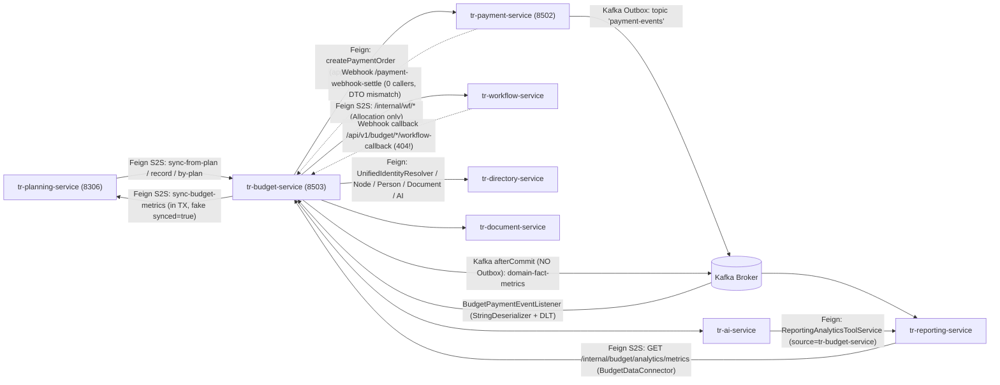

# Đánh giá Tích hợp Microservices, Feign, Kafka & Outbox (`tr-budget-service`)

> **Phạm vi kiểm toán**: Tích hợp 2 chiều giữa `tr-budget-service` với `tr-planning-service`, `tr-payment-service`, `tr-workflow-service`, `tr-directory-service`, `tr-document-service`, `tr-reporting-service` và `tr-ai-service`; kiểm tra hợp đồng DTO S2S (`tr-common-feign`), xác thực webhook/Same-Token, idempotency, Kafka Producer/Consumer/DLT và cơ chế Circuit Breaker.
>
> **Ngày kiểm toán**: 2026-11-26 | **Chế độ**: Chỉ đọc & Đánh giá (không sửa mã nguồn).

## 1. Tổng quan Điểm số & Nhận định

| Tiêu chí | Điểm (`/10`) | Nhận định nhanh |
| --- | --- | --- |
| Tích hợp 2 chiều `tr-planning-service` | 5.0 / 10 | Có đủ API `sync-from-plan`, `by-plan`, `record` và chiều đẩy ngược `sync-budget-metrics`; nhưng chiều đẩy ngược nói dối `"synced": true` khi lỗi (không có Outbox/Retry) và chạy bên trong `@Transactional`. |
| Tích hợp `tr-payment-service` (Webhook & Kafka) | 3.0 / 10 | Consumer Kafka `payment-events` có idempotency cơ bản và DLT; nhưng endpoint `payment-webhook-settle` bị **lệch hợp đồng DTO hoàn toàn**, bỏ qua `paidAmount`/`paymentStatus`, không idempotent, không có caller thực tế và hardcode `appCode="budget"`. |
| Tích hợp `tr-workflow-service` | 4.5 / 10 | Đã chuyển lời gọi đi sang `*Internal` (`BudgetIntegrationOrchestrator:512-572`); nhưng 4/4 callback URL sai đường dẫn và chỉ kết nối được 1/4 thực thể (`BudgetAllocation`). |
| Tích hợp `tr-directory` / `tr-document` / `tr-reporting` / `tr-ai` | 6.5 / 10 | `BudgetDataConnector` (pull) và `BudgetFactMetricPublisher` (push sau `afterCommit`) kết nối tốt với `tr-reporting-service` và `tr-ai-service`; nhưng chưa dùng `OutboxPublisher`, `AiClient` không có circuit breaker và có rủi ro prompt injection. |
| Resilience, Circuit Breaker & Outbox Pattern | 4.5 / 10 | Cấu hình YAML `resilience4j.circuitbreaker` hoàn toàn **vô hiệu** vì thiếu dependency; tự viết backoff thủ công `volatile long` 60s chia sẻ sai giữa 2 client; không có `sys_outbox_event`. |
| **Tổng điểm Tích hợp Microservices** | **4.8 / 10** | **Phát hiện nhiều lỗi hợp đồng S2S, mất tính nhất quán dữ liệu liên dịch vụ và thiết kế tích hợp chưa chịu lỗi (fault-tolerant).** |

## 2. Bản đồ Tích hợp Liên dịch vụ

## 3. Kiểm toán Chi tiết Từng Điểm Tích hợp

### 3.1 `tr-payment-service` — Lệch Hợp đồng DTO & Mất Idempotency (`INT-C01`)

#### A. Lỗi Hợp đồng Webhook (`POST /internal/budget/disbursements/{id}/payment-webhook-settle`)

1. **Lệch hoàn toàn tên trường DTO**:
   - `BudgetPaymentSettleData.java:25-31` định nghĩa: `transactionCode`, `paymentOrderId`, `paidAmount`, `paymentStatus`, `paidAt`, `disbursementCode`, `appCode`.
   - `BudgetInternalController.java:101-102` chuyển đổi DTO sang `Map` bằng `objectMapper.convertValue(request, Map.class)` nên các key trong Map là `"transactionCode"`, `"paidAmount"`, `"paymentStatus"`...
   - Tuy nhiên `BudgetDisbursementBusiness.settleFromPaymentWebhook:953-969` lại đọc `body.get("paymentTxCode")`, `body.get("treasuryRefCode")`, `body.get("voucherNo")` — **tất cả đều luôn là `null`** khi gọi qua `BudgetInternalClient`! Kết quả là hệ thống luôn tự bịa mã giả `"PAY-WH-" + code`, `"KBNN-AUTO-" + id`, `"UNC-WH-" + code`.
2. **Bỏ qua hoàn toàn `paidAmount` và `paymentStatus`**:
   - Dòng `973`: Gán cứng `disb.setSettledAmount(disb.getAmount())` bất kể khách hàng/kho bạc thực trả bao nhiêu (`paidAmount`).
   - Không kiểm tra `"PAID".equalsIgnoreCase(paymentStatus)` -> kể cả webhook báo `"FAILED"` hoặc `"CANCELLED"`, hồ sơ giải ngân vẫn bị đóng dấu `"SETTLED"`!
3. **Không có Idempotency & Không kiểm tra trạng thái nguồn**:
   - Không kiểm tra `disb.getApprovalStatus()` (có thể quyết toán cả hồ sơ `DRAFT` hoặc `REJECTED`, và gọi lặp lại nhiều lần sẽ bắn trùng thông báo, đồng bộ kế hoạch và fact metrics nhiều lần).
4. **Không có caller thực tế ở `tr-payment-service` & Thiếu xác thực nội bộ**:
   - `PaymentRealtimeNotifier.java:34,78-96,184` chỉ phát `PaymentCompletedEvent` lên Kafka topic `payment-events` (không gọi Feign webhook).
   - Endpoint không có HMAC signature và bị `@SaIgnore` ở `BudgetInternalController.java:45` vô hiệu hóa kiểm tra `SaSameUtil` (xem chi tiết `SEC-C01`).

#### B. Luồng Consumer Kafka (`BudgetPaymentEventListener` -> `settleFromPaymentEvent`)

- **Điểm tốt**: `tr-common-kafka/KafkaConfig.java:124-125` cấu hình `StringDeserializer` kèm `DeadLetterPublishingRecoverer` (DLT) và `DefaultErrorHandler`, đồng thời `settleFromPaymentEvent` đã kiểm tra trạng thái `"SETTLED"` trước khi xử lý lại.
- **Điểm yếu (`INT-H01`)**:
  - **Xung đột cấu hình YAML**: `application.yml:181` đặt `BUDGET_PAYMENT_KAFKA_ENABLED:false` (tắt mặc định) trong khi `_base:188` bật `true`; `application.yml:108-110` và `_base:93-95` cấu hình `JsonDeserializer` + `spring.json.trusted.packages: "*"` dù `KafkaConfig` ghi đè thành `StringDeserializer`.
  - **Lọc tenant quá hẹp (`BudgetDisbursementBusiness.java:834-838`)**: Loại bỏ sự kiện nếu `appCode` khác `"budget"` trừ khi `sourceModule` chứa chuỗi `"BUDGET"`, gây rơi sự kiện ở các tenant (`ict-dng`, `sct`, `sgtvt`) nếu `sourceModule` đặt khác.
  - **Chiều tạo lệnh thanh toán (`BudgetIntegrationOrchestrator.java:452,480-482`)**: Hardcode `.appCode("budget")` khi gọi `PaymentClient` (sai tenant trên hệ thống đa đơn vị!), chạy bên trong `@Transactional` của `BudgetDisbursementBusiness`, và tự bịa mã `"PAY-KBNN-" + code` khi Feign lỗi.

### 3.2 `tr-planning-service` — Đồng bộ 2 chiều & "Lời nói dối" `synced: true` (`INT-C02`)

- **Chiều Kế hoạch -> Ngân sách**: `PlanIntegrationOrchestrator.java:646,693` gọi `BudgetInternalClient.syncAllocationFromPlan` và `recordPlanLedgerTransaction`. (Lưu ý: cũng bị ảnh hưởng bởi `@SaIgnore` trên `BudgetInternalController:45` và dùng `objectMapper.convertValue(..., Map.class)` dễ phát sinh lệch key nếu DTO thay đổi).
- **Chiều Ngân sách -> Kế hoạch (`BudgetIntegrationOrchestrator.syncAllocationToLinkedPlan:390-435`)**:
  - Được gọi **bên trong DB Transaction (`@Transactional`)** của `BudgetAllocationBusiness` và `BudgetDisbursementBusiness`, giữ kết nối HikariCP và khóa hàng `budget_allocation` trong suốt thời gian chờ HTTP Feign!
  - Khi `tr-planning-service` gặp sự cố hoặc đang trong backoff, hàm trả về **`"synced": true, "syncMode": "LOCAL_DEFERRED_SNAPSHOT"`** (`lines 425-426`) nhưng **không lưu bất kỳ bản ghi Outbox hay hàng đợi thử lại nào** -> dữ liệu thực chi giữa Planning và Budget lệch vĩnh viễn!

### 3.3 `tr-reporting-service`, `tr-ai-service`, `tr-directory-service` & `tr-document-service`

- **`tr-reporting-service` (Pull + Push)**:
  - *Pull*: `BudgetDataConnector.java:17-69` gọi `BudgetInternalClient.getInternalAnalyticsMetrics` (`/internal/budget/analytics/metrics`) — đây là endpoint duy nhất trong `BudgetInternalController` có gọi tường minh `SaSameUtil.checkCurrentRequestToken()` (`line 125`).
  - *Push*: `BudgetFactMetricPublisher.java:165-188` đăng ký `TransactionSynchronization.afterCommit()` để gửi lên Kafka topic `domain-fact-metrics` (tốt vì tránh phát event khi transaction rollback), nhưng gửi fire-and-forget không có `OutboxPublisher` / `sys_outbox_event` -> mất sự kiện thống kê nếu Kafka broker gián đoạn.
- **`tr-ai-service`**:
  - *Chiều AI -> Budget*: `ReportingAnalyticsToolService.java:52` đọc gián tiếp số liệu `tr-budget-service` thông qua `tr-reporting-service`.
  - *Chiều Budget -> AI*: `BudgetDashboardBusiness.java:997` gọi trực tiếp `AiClient` không có circuit breaker/backoff và ghép trực tiếp dữ liệu người dùng vào prompt thô (nguy cơ Prompt Injection).
- **`tr-directory-service` & `tr-document-service`**: Tích hợp 1 chiều để tra cứu/làm giàu thông tin `nodeName`, `personName`, `decisionDocumentId` (`DocumentClient`, `DirectoryNodeClient`, `DirectoryPersonClient`, `UnifiedIdentityResolver`). `tr-document-service` không gọi ngược về `tr-budget-service`.

### 3.4 Circuit Breaker & Cơ chế Chịu lỗi (`INT-H02`)

- **Cấu hình Resilience4j trong YAML là cấu hình chết**: `config/_base/tr-budget-service.yml:264-272` khai báo `resilience4j.circuitbreaker.instances.*`, nhưng `pom.xml` **không có** `spring-cloud-starter-circuitbreaker-resilience4j` hay `resilience4j-spring-boot3`, và toàn bộ mã nguồn có **0** annotation `@CircuitBreaker` / `@Retry`.
- **Backoff thủ công lỗi thiết kế (`BudgetIntegrationOrchestrator.java:79-83`)**:
  - Dùng các biến `volatile long *BackoffUntil` với chu kỳ cứng `60_000 ms` (chỉ có tác dụng trong 1 JVM, không theo dõi tỷ lệ lỗi trượt).
  - Dùng chung một cờ `identityBackoffUntil` cho cả `UnifiedIdentityResolver` lẫn `DirectoryPersonClient` -> lỗi 1 client làm ngắt luôn client còn lại trong 60 giây!
  - `AiClient` trong `BudgetDashboardBusiness` hoàn toàn không có backoff hay fallback timeout riêng.

## 4. Danh mục Phát hiện Tích hợp & Xếp hạng Mức độ

| Mã lỗi | Mức độ | Vị trí (`file:line`) | Mô tả vấn đề | Khuyến nghị khắc phục |
| --- | --- | --- | --- | --- |
| `INT-C01` | **CRITICAL** | `BudgetPaymentSettleData.java:25-31`; `BudgetInternalController.java:97-104`; `BudgetDisbursementBusiness.java:947-1017` | Lệch hoàn toàn key DTO (`transactionCode` vs `paymentTxCode`, `treasuryRefCode`, `voucherNo` luôn `null`); bỏ qua `paidAmount` & `paymentStatus`; thiếu idempotency; không có caller thực tế từ `tr-payment-service`. | Bỏ `objectMapper.convertValue(..., Map.class)`, truyền thẳng typed `BudgetPaymentSettleData` vào Business; kiểm tra `paymentStatus == PAID`, đối chiếu `paidAmount`, kiểm tra trạng thái + bảng `budget_processed_event` và xác thực Same-Token/HMAC. |
| `INT-C02` | **CRITICAL** | `BudgetIntegrationOrchestrator.java:390-482`; `BudgetDisbursementBusiness.java:453,995`; `BudgetFactMetricPublisher.java:165-188` | Không có Transactional Outbox (`sys_outbox_event`); `syncAllocationToLinkedPlan` báo `"synced": true` giả khi lỗi; gọi Feign bên trong `@Transactional`; hardcode `appCode="budget"` & bịa mã `"PAY-KBNN-*"`; Kafka fact publisher fire-and-forget dễ mất dữ liệu. | Triển khai `OutboxPublisher` + bảng `sys_outbox_event` cho cả Kafka và tác vụ đồng bộ bất đồng bộ; đưa toàn bộ Feign call ra ngoài `@Transactional`; truyền `HeaderContext.getAppCode()` thay vì `"budget"`. |
| `INT-H01` | **HIGH** | `application.yml:108-110,181`; `config/_base/tr-budget-service.yml:93-95,188`; `BudgetDisbursementBusiness.java:834-838` | Xung đột cấu hình Kafka (`BUDGET_PAYMENT_KAFKA_ENABLED` false/true, `JsonDeserializer` + `trusted.packages: "*"` trong YAML vs `StringDeserializer` thực tế); consumer lọc cứng `appCode="budget"` dễ rơi event multi-tenant; thiếu bảng `budget_processed_event`. | Thống nhất cấu hình Kafka YAML khớp với `tr-common-kafka` (bỏ `trusted.packages: "*"`), lọc sự kiện theo `sourceModule` chuẩn hoặc `pay_transaction_id` thay vì hardcode `appCode="budget"`, lưu event ID vào `budget_processed_event`. |
| `INT-H02` | **HIGH** | `config/_base/tr-budget-service.yml:264-272`; `pom.xml`; `BudgetIntegrationOrchestrator.java:79-83`; `BudgetDashboardBusiness.java:997` | Cấu hình Resilience4j trong YAML vô hiệu vì thiếu starter; backoff thủ công dùng chung cờ giữa các client; `AiClient` không có circuit breaker & truyền prompt chưa làm sạch. | Thêm `spring-cloud-starter-circuitbreaker-resilience4j`, gắn `@CircuitBreaker` riêng từng peer client, bỏ `volatile long` thủ công và chuẩn hóa/escape dữ liệu đầu vào trước khi gửi `AiClient`. |
| `INT-H03` | **HIGH** | `BudgetAllocationBusiness.java:726`; `BudgetTransactionBusiness.java:2598`; `BudgetDisbursementBusiness.java:1057`; `BudgetReportBusiness.java:1524`; `config/dev/tr-budget-service-dev.yml:83` | 4/4 workflow callback URL sai path (404); lệch tên `reporting-service-name: dev-reporting-service` và `sct/sgtvt-budget-service` ở `tr-workflow-service`. | Thống nhất callback về `/workflow/callback` và chuẩn hóa tên Eureka đồng nhất theo `${*_SERVICE_NAME:tr-*-service}`. |
