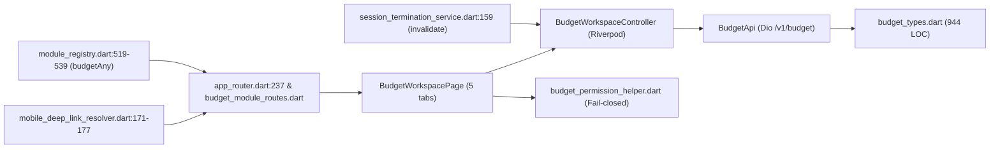

# Phân tích Mobile Flutter (Module `budget` — `apps/dds_app`)

> **Phạm vi kiểm toán**: `tr-mobile/tr-flutter-app/apps/dds_app/lib/api/budget/*`, `lib/views/modules/budget/**`, `lib/router/routes/budget_module_routes.dart`, `test/modules/budget_workspace_test.dart`, cùng các điểm tích hợp hệ thống (`app_router.dart`, `module_registry.dart`, `session_termination_service.dart`, `mobile_deep_link_resolver.dart`, `packages/shared/.../permission_constants.dart`).
> **Điểm trưởng thành Mobile Flutter**: **5.0 / 10** *(UI 5 tab đầy đủ cho kịch bản lãnh đạo phê duyệt nhanh, `flutter analyze` đạt 0 cảnh báo và `flutter test` đạt 6/6, nhưng dính lỗi nạp nguyên tử 14 API dễ sập toàn màn hình khi thiếu 1 quyền, 4 trường `UnitConfig` sai tên JSON, tạo ID giả cho giao dịch sau thao tác 1 chạm, nuốt toàn bộ lỗi server và chưa tách thành package tái sử dụng `packages/features/budget`)*.

---

## 1. Kiến trúc Module & Tích hợp Hệ sinh thái Flutter

Khác với 6 phân hệ đã được tách thành gói tái sử dụng trong `tr-mobile/tr-flutter-app/packages/features/*` (`attendance`, `directory`, `document`, `feature_reporting`, `task`, `workflow`), phân hệ Ngân sách hiện vẫn nằm **nguyên khối (monolithic)** bên trong ứng dụng `apps/dds_app` (và được loại trừ có chủ đích khỏi phạm vi `apps/app_bacninh` theo `apps/app_bacninh/README.md:35`).

### 1.1. Thống kê Quy mô Mã nguồn & Tuân thủ Giới hạn 400 Dòng

| Tệp nguồn (`apps/dds_app/`) | Số dòng (LOC) | Vượt chuẩn 400 LOC | Vai trò |
| --- | --- | --- | --- |
| `lib/api/budget/budget_types.dart` | 944 | **Vượt (+544)** | 15+ model DTO, hàm `fromJson`, `formatBudgetCurrencyVnd` |
| `lib/views/modules/budget/stores/budget_store.dart` | 827 | **Vượt (+427)** | Riverpod `BudgetWorkspaceController` quản lý state 5 tab + 20 mutation |
| `lib/api/budget/budget_api.dart` | 639 | **Vượt (+239)** | Dio client gọi 45 endpoint của `tr-budget-service` |
| `lib/views/modules/budget/views/widgets/budget_disbursements_tab.dart` | 493 | **Vượt (+93)** | Tab Giải ngân + BottomSheet lập đề nghị chi/cam kết |
| `lib/views/modules/budget/views/widgets/budget_overview_ai_tab.dart` | 474 | **Vượt (+74)** | Tab Tổng quan KPI, Ma trận đơn vị, AI Advisor, What-If |
| `lib/views/modules/budget/views/widgets/budget_ledger_tab.dart` | 466 | **Vượt (+66)** | Tab Sổ cái + 9 chip tác nghiệp điều chỉnh (`NV-01..DX-04`) |
| `lib/views/modules/budget/views/widgets/budget_reports_tab.dart` | 375 | Đạt | Tab Báo cáo định kỳ, Ma trận lĩnh vực, Đối chiếu KBNN |
| `lib/views/modules/budget/views/budget_workspace_page.dart` | 362 | Đạt | Shell 5 tab + chọn năm ngân sách + banner trạng thái |
| `lib/views/modules/budget/views/widgets/budget_allocations_tab.dart` | 245 | Đạt | Tab Phương án phân bổ & nút Phê duyệt / Đồng bộ KH |
| `lib/views/modules/budget/views/widgets/budget_permission_helper.dart` | 214 | Đạt | Helper kiểm tra phân quyền Fail-closed theo `BudgetAction` |
| `lib/router/routes/budget_module_routes.dart` | 38 | Đạt | Định nghĩa 6 tuyến `/budget/*` ánh xạ về `BudgetWorkspacePage` |
| `test/modules/budget_workspace_test.dart` | 915 | Test file | 6 kịch bản test (`TC-MOB-BUD-01`..`06`) |

Có **6/11 tệp production (54.5%) vượt ngưỡng 400 LOC** (`MOB-M01`), đặc biệt `budget_types.dart` (944 LOC) và `budget_store.dart` (827 LOC) tập trung toàn bộ 5 miền nghiệp vụ vào một StateNotifier đơn nhất.

---

## 2. Lỗi Kiến trúc Tải Dữ liệu & Trạng thái (`budget_store.dart`)

### 2.1. Tải Nguyên tử 14 Endpoint Không Có Chống Lỗi Từng Phần (`MOB-C01`)

Tại `lib/views/modules/budget/stores/budget_store.dart:142-218`, hàm `loadWorkspace()` gọi `Future.wait(...)` đồng thời cho **toàn bộ 14 endpoint** từ 7 controller (`dashboard/overview`, `allocations`, `transactions`, `disbursements`, `reports`, `dashboard/ai-advisor`, `dashboard/burn-rate-forecast`, `dashboard/disbursement-scorecard`, `reports/kbnn-reconciliation`, `reports/dynamic-domain-matrix`, `categories/year-domain-configs`, `dashboard/revenue-expenditure-tree`, `unit-configs`, `transactions/operation-role-matrix`) **mà không lọc theo quyền của người dùng và không bọc `catchError` riêng từng lời gọi**.

- **Hậu quả nghiêm trọng**: Một kế toán đơn vị chỉ có quyền `BudgetAllocationList` và `BudgetDisbursementList` (không có `BudgetDashboardQuery` hay `BudgetUnitConfigList`) khi mở màn hình sẽ nhận HTTP `403` ở 1 trong 14 request → `Future.wait` ném ngoại lệ ngay lập tức → rơi vào khối `catch` đặt `isOfflineFallback = true` → **toàn bộ 5 tab đều trắng dữ liệu (0 bản ghi)** dù người dùng có quyền xem 2 tab kia!
- Đồng thời, mọi lần đổi năm ngân sách đều bắn 14 request mạng song song gây quá tải băng thông 4G/5G và làm chậm thời gian hiển thị đầu tiên.

### 2.2. Tự Bịa ID Giao dịch & Nuốt Lỗi Server (`MOB-H01`, `MOB-H02`)

1. **Tự bịa ID tổng hợp sau thao tác 1 chạm (`MOB-H01`)**:
   - `budget_store.dart:562` (`executeSmartReallocationOneTap`) và `budget_store.dart:765` (`executeAuxiliaryOperationOneTap`) tự tạo `id = DateTime.now().millisecondsSinceEpoch % 100000` và đọc nhầm khóa cấp 1 `res['code']` thay vì `res['transaction']['code']` (dẫn tới fallback mã cứng `'TX-SMART-2026-01'`).
   - Nếu người dùng nhấn **Phê duyệt** hoặc **Từ chối** ngay trên thẻ bút toán vừa tạo trên UI, ứng dụng gửi ID giả lên `POST /transactions/{fakeId}/approve` → **HTTP 404 hoặc duyệt nhầm bút toán khác nếu trùng ID**!
2. **Nuốt sạch thông báo lỗi nghiệp vụ từ Backend (`MOB-H02`)**:
   - Toàn bộ **20 phương thức mutation** trong `budget_store.dart` đều bọc `try { ... } catch (_) { return 'Không thể ...'; }`. Mọi phản hồi chi tiết từ BE (như vượt dự toán khả dụng, vượt hạn mức tự duyệt NĐ 60, thiếu số chứng từ `voucherNo`, HTTP `403`/`409`) đều bị giấu đi, khiến người dùng không biết nguyên nhân thất bại.
3. **Sinh mã đối soát Kho bạc cứng theo tenant Đà Nẵng (`MOB-M02`)**:
   - `budget_store.dart:310` tự ghép chuỗi `'KBNN-DN-${state.selectedBudgetYear}-$disbursementId'` làm `treasuryRefCode` ở phía client, vừa gán cứng mã tỉnh Đà Nẵng (`DN`) vừa tự sinh số chứng từ Kho bạc thay vì nhận từ người dùng/KBNN.

---

## 3. Lệch Hợp đồng API, Sai tên Trường JSON & Dữ liệu Mặc định Nguy hiểm

### 3.1. Bảng Đối chiếu Lỗi Contract Mobile ↔ Backend

| Mã lỗi | Tệp & Dòng | Sai lệch trên Mobile | Hợp đồng Backend thực tế | Tác động |
| --- | --- | --- | --- | --- |
| `MOB-H03` | `lib/api/budget/budget_types.dart:935-941` | `BudgetUnitConfigModel.fromJson` đọc 4 khóa sai: `autonomyType`, `autonomyRatioPercent`, `selfApprovalLimitAmount`, `treasuryAgencyName` | `BudgetUnitConfigData` trả về `unitType`, `recurrentSelfGuaranteeRate`, `selfApproveLimitAmount`, `treasuryBranchName` | Thông tin tự chủ đơn vị trên Mobile **luôn rơi về mặc định sai** (`GROUP_2`, `100%`, `0đ`, `''`) |
| `MOB-H04` | `lib/api/budget/budget_types.dart:248,367,515,585-631` | Khi API thiếu trường `status`/`workflowStatus`, 3 model tự mặc định là **`'APPROVED'`**! Đồng thời `BudgetScorecardItemModel` và `BudgetKbnnReconciliationRowModel` tự điền giá trị giả khi rỗng (`'VAN_PHONG_SO'`, `'Văn phòng Sở'`, `85.0`, `'TOT'`, `'PB-2026-01'`, `'281'`) | Trạng thái ban đầu là `DRAFT`/`PENDING_APPROVAL`; điểm & đối chiếu KBNN phải phản ánh dữ liệu thật hoặc rỗng | Hiển thị sai chứng từ chưa duyệt thành **Đã phê duyệt** và tạo báo cáo KBNN giả |
| `MOB-H05` | `lib/views/modules/budget/views/widgets/budget_ledger_tab.dart:22-86,437-452` | `_auxSpecs` điền sẵn số tiền mẫu **1,5 – 2,655 tỷ VNĐ** và mã lĩnh vực cứng (`CDS`, `TCDLCL`, `KHCN`); form gửi cùng một `_domainCtrl` cho cả `domainCode` và `nodeCode`, bỏ sót nhiều trường bắt buộc (`allocationCode`, `fromDomainCode`, `toDomainCode`, `reason`) | `BudgetTransactionController` yêu cầu đúng các trường payload theo từng nghiệp vụ `NV-01..DX-04` | Nguy cơ gửi nhầm số tiền hàng tỷ đồng mẫu lên server thật hoặc lỗi nghiệp vụ BE |
| `MOB-H06` | `lib/views/modules/budget/views/widgets/budget_disbursements_tab.dart:35-42,369-377,474-475` | BottomSheet tạo giải ngân điền sẵn **`1.250.000.000` VNĐ**, `'HĐ-2026-CKC-01'`, và ô nhập số nguyên `allocationId` mặc định `'1'` (không có dropdown chọn phân bổ); `_typeLabel` ánh xạ `'PAYMENT'` thay vì `'DISBURSEMENT'`/`'SETTLEMENT'` | Enum `BudgetDisbursementType` gồm `COMMITMENT`, `ADVANCE`, `DIRECT_PAYMENT`, `DISBURSEMENT`, `SETTLEMENT`, `ADVANCE_SETTLEMENT` | Người dùng dễ bấm nhầm gửi giải ngân 1,25 tỷ vào `allocationId = 1` và hiển thị sai nhãn loại chứng từ |
| `MOB-M03` | `lib/views/modules/budget/views/widgets/budget_reports_tab.dart:230,247`, `budget_workspace_page.dart:258`, `budget_api.dart`, `budget_types.dart` | Hardcode ngày mốc `'2026-10-23'`/`'2026-10-30'` bỏ qua `selectedBudgetYear`; hardcode năm `2026` ở hơn 20 chỗ và danh sách năm cố định `[2024, 2025, 2026, 2027]` | BE nhận `budgetYear` và `asOfDate` động | Ứng dụng lỗi thời sau năm 2027 và đối chiếu sai ngày khi xem năm khác 2026 |
| `MOB-M04` | `lib/api/budget/budget_api.dart` & `budget_store.dart:476` | 3 phương thức API (`scanDisbursementSlaAlerts`, `getTargetScopeContext`, `validateTargetScope`) và 1 hàm store (`confirmReportTreasuryReconciliation`) không được gắn vào bất kỳ nút UI nào | Đã có endpoint đầy đủ trên BE | Mã chết / tính năng chưa hoàn thiện nối giao diện |

---

## 4. Phân quyền Mobile & Lệch Guard với Backend (`MOB-H07`, `MOB-H08`)

Điểm tích cực của Mobile là `hasBudgetPermission` (`budget_permission_helper.dart:7-14`) tuân thủ chặt chẽ nguyên tắc **Fail-Closed** (`null` hoặc rỗng → trả về `false`), vượt trội hơn cơ chế fail-open của Web FE. Tuy nhiên, còn tồn tại **5 lỗi phân quyền nghiêm trọng**:

1. **Chặn nhầm người dùng chỉ có quyền Dashboard ở tầng GoRouter (`MOB-H07`)**:
   - `packages/shared/lib/src/constants/permission_constants.dart:629-660` chỉ khai báo 20/107 mã quyền của Budget và danh sách `budgetAny` (dùng bởi `app_router.dart:237` và `module_registry.dart:525,539`) **bỏ sót `BudgetDashboardQuery`**. Lãnh đạo chỉ được gán quyền xem Dashboard sẽ bị GoRouter chặn vào `/budget/dashboard`!
2. **3 điểm lệch mã quyền giữa nút Mobile và Controller BE (`MOB-H08`)**:
   - **Đồng bộ KH** (`budget_allocations_tab.dart:38,196`): kiểm tra `BudgetAllocationEdit` trong khi BE yêu cầu **`BudgetAllocationApprove`**.
   - **9 chip nghiệp vụ phụ Sổ cái** (`budget_ledger_tab.dart:141,149`): toàn bộ 9 chip đều kiểm tra `BudgetTransactionCreate`, trong khi BE yêu cầu **`BudgetTransactionSubmit`** (6 nghiệp vụ) hoặc **`BudgetTransactionApprove`** (3 nghiệp vụ `DX-02..04`).
   - **Xuất mẫu C2-02a/NS** (`budget_disbursements_tab.dart:150,295`): kiểm tra `BudgetDisbursementExport`, trong khi BE yêu cầu **`BudgetDisbursementDetail OR BudgetDisbursementApprove`**.
3. **Thiếu lọc trạng thái trên nút Phê duyệt Báo cáo (`MOB-M05`)**:
   - `budget_reports_tab.dart:145` hiển thị nút "Phê duyệt báo cáo" bất cứ khi nào `canApprove == true` mà **không kiểm tra `workflowStatus`**, khiến nút vẫn xuất hiện trên báo cáo `DRAFT`, `APPROVED`, `LOCKED_SETTLED` và `REJECTED`.
4. **Không hỗ trợ mã quyền tiền tố App hoặc Wildcard tiền tố**:
   - `budget_permission_helper.dart:7-14` chỉ so khớp chuỗi chính xác hoặc `*`/`*:*:*`, không hỗ trợ tiền tố ứng dụng `budget:BudgetAllocationApprove` hay wildcard `BudgetAllocation*`.

---

## 5. UX Tài chính trên Di động, Offline & Chất lượng Kiểm thử

### 5.1. Rủi ro UX Tài chính & Thiếu năng lực Di động Chuẩn

1. **Không có Xác nhận Hai bước / Sinh trắc học cho Phê duyệt Tiền tỷ (`MOB-H09`)**:
   - Các nút **Phê duyệt**, **Tự phê duyệt**, **Giải ngân**, **Chuyển nguồn thông minh 1 chạm** trên 5 tab đều thực thi ngay lập tức sau 1 lần chạm, **không có hộp thoại xác nhận số tiền/chứng từ** (`showDialog`) và **không tích hợp xác thực sinh trắc học** (`local_auth`) dù tác động trực tiếp tới ngân sách hàng tỷ đồng.
2. **Định dạng Tiền tệ kém chính xác (`MOB-M06`)**:
   - `formatBudgetCurrencyVnd` (`budget_types.dart:6-18`) làm tròn hàng triệu về **0 chữ số thập phân** (`150.800.000` → `"151 tr.đ"`), không thêm dấu phân tách hàng nghìn cho số `< 1 triệu` (`950000` → `"950000 đ"`), và dùng kiểu `double`.
3. **Thiếu các tiện ích Mobile thiết yếu (`MOB-M07`)**:
   - Không có `RefreshIndicator` (kéo để làm mới) trên 5 tab.
   - Không có phân trang server (`size: 50` cố định) hay cuộn vô hạn (`infinite scroll`).
   - Không lưu cache ngoại tuyến mã hóa AES-256 (`EncryptedOfflineStorage`) — khi mất mạng ở chế độ `isOfflineFallback = true`, người dùng không xem được số liệu gần nhất đã đồng bộ.
   - Chưa tách gói độc lập `packages/features/budget` để tái sử dụng cho các ứng dụng Sở/Ngành khác (`MOB-M08`).

### 5.2. Kết quả Kiểm chứng Thực thi Trực tiếp (Live Verification)

| Lệnh kiểm chứng | Kết quả | Chi tiết thực đo |
| --- | --- | --- |
| `flutter analyze --no-pub --no-fatal-infos` (13 tệp Dart của budget) | **PASS (Exit 0)** | `No issues found! (ran in 3.1s)` |
| `flutter test test/modules/budget_workspace_test.dart --reporter compact` | **PASS (6/6 tests, 6s)** | `TC-MOB-BUD-01`..`06` đều xanh; kiểm tra đủ 5 tab, quyền fail-closed, thao tác phê duyệt/giải ngân/báo cáo qua Fake API |
| Điểm yếu của bộ Test Mobile | **Chưa bắt được lỗi thực tế** | Test dùng mock JSON tự chế khớp với tên field sai của `budget_types.dart` nên **không phát hiện 4 khóa sai của `BudgetUnitConfigModel`**, không test lỗi partial 403 trong `Future.wait(14)`, và không có Widget/Integration test cho lỗi HTTP thực tế |

---

## 6. Tổng hợp Phát hiện Mobile Flutter

| Mã | Mức độ | Tóm tắt phát hiện | Vị trí chính |
| --- | --- | --- | --- |
| `MOB-C01` | CRITICAL | `Future.wait` nguyên tử 14 endpoint không lọc theo quyền — 1 lỗi 403 làm trắng toàn bộ 5 tab | `budget_store.dart:142-218` |
| `MOB-H01` | HIGH | Tạo ID giao dịch giả bằng `millisecondsSinceEpoch % 100000` và đọc sai cấu trúc response | `budget_store.dart:562,765` |
| `MOB-H02` | HIGH | Toàn bộ 20 mutation nuốt sạch thông báo lỗi từ server bằng `catch (_)` | `budget_store.dart` |
| `MOB-H03` | HIGH | `BudgetUnitConfigModel.fromJson` sai 4 khóa JSON (`unitType`, `recurrentSelfGuaranteeRate`, `selfApproveLimitAmount`, `treasuryBranchName`) | `budget_types.dart:935-941` |
| `MOB-H04` | HIGH | Mặc định trạng thái thiếu thành `'APPROVED'` và điền dữ liệu giả cho Scorecard & đối chiếu KBNN | `budget_types.dart:248,367,515,585-631` |
| `MOB-H05` | HIGH | `_auxSpecs` điền sẵn số tiền 1,5–2,655 tỷ mẫu, gửi nhầm `domainCode` vào `nodeCode`, thiếu trường bắt buộc | `budget_ledger_tab.dart:22-86,437-452` |
| `MOB-H06` | HIGH | Form giải ngân điền sẵn `1,25 tỷ` & `allocationId = 1` dạng text thô; lệch enum `'PAYMENT'` vs `'DISBURSEMENT'` | `budget_disbursements_tab.dart:35-42,369-377` |
| `MOB-H07` | HIGH | `PermissionConstants.budgetAny` bỏ sót `BudgetDashboardQuery` khiến GoRouter chặn người dùng chỉ có quyền Dashboard | `permission_constants.dart:629-660`, `app_router.dart:237` |
| `MOB-H08` | HIGH | 3 điểm lệch quyền nút Mobile vs BE (`syncToPlan`, 9 chip Sổ cái, xuất mẫu C2-02a/NS) gây HTTP 403 | `budget_allocations_tab.dart:38`, `budget_ledger_tab.dart:141`, `budget_disbursements_tab.dart:150` |
| `MOB-H09` | HIGH | Không có hộp thoại xác nhận hoặc sinh trắc học trước các thao tác phê duyệt/giải ngân tiền tỷ 1 chạm | Toàn bộ 5 tab trong `lib/views/modules/budget/views/widgets/` |
| `MOB-M01` | MEDIUM | 6/11 tệp production vượt 400 LOC (lớn nhất `budget_types.dart` 944 LOC, `budget_store.dart` 827 LOC) | `lib/api/budget/*`, `lib/views/modules/budget/**` |
| `MOB-M02` | MEDIUM | Tự sinh mã đối soát Kho bạc cứng theo Đà Nẵng `'KBNN-DN-...'` ở phía client | `budget_store.dart:310` |
| `MOB-M03` | MEDIUM | Hardcode năm `2026` (>20 vị trí), danh sách năm `[2024..2027]` và mốc ngày `'2026-10-23'`/`'2026-10-30'` | `budget_reports_tab.dart:230,247`, `budget_workspace_page.dart:258` |
| `MOB-M04` | MEDIUM | 3 hàm API và `confirmReportTreasuryReconciliation` là mã chết chưa gắn vào UI | `budget_api.dart`, `budget_store.dart:476` |
| `MOB-M05` | MEDIUM | Nút "Phê duyệt báo cáo" không lọc theo trạng thái `PENDING_APPROVAL` | `budget_reports_tab.dart:145` |
| `MOB-M06` | MEDIUM | `formatBudgetCurrencyVnd` làm tròn hàng triệu về 0 chữ số thập phân, không dấu phẩy `< 1 triệu` | `budget_types.dart:6-18` |
| `MOB-M07` | MEDIUM | Thiếu Pull-to-Refresh, thiếu phân trang server (`size: 50`) và thiếu cache offline AES-256 | `budget_workspace_page.dart`, `budget_store.dart` |
| `MOB-M08` | MEDIUM | Chưa tách thành `packages/features/budget` như 6 module chuẩn khác của `tr-flutter-app` | `apps/dds_app/lib/views/modules/budget/` |
