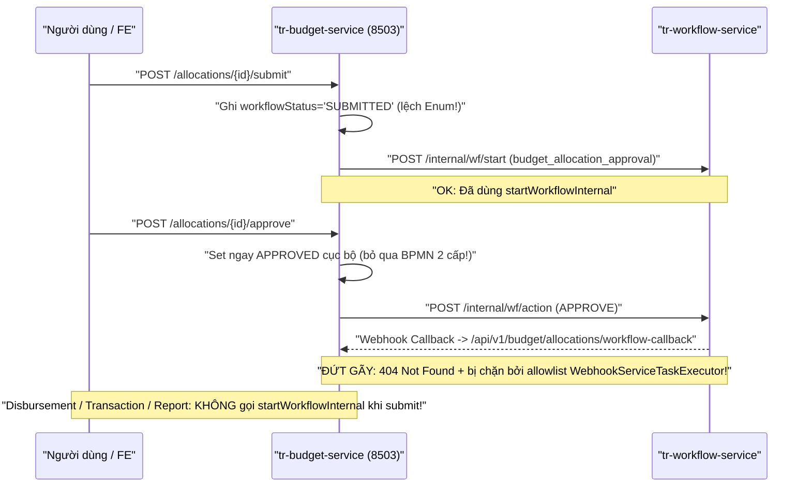

# Đánh giá Quy trình Phê duyệt, Phân tách Nhiệm vụ (SoD) & SLA (`tr-budget-service`)

> **Phạm vi kiểm toán**: Cơ chế tự duyệt/trình duyệt theo hạn mức (`BudgetApprovalScope`), kiểm soát phân tách nhiệm vụ (Segregation of Duties — SoD theo Luật Kế toán 88/2015/QH13 & Nghị định 174/2016/NĐ-CP), tích hợp 2 chiều với `tr-workflow-service` (BPMN 2.0, `AbstractWorkflowBusiness`, `BudgetIntegrationOrchestrator`), luồng thu hồi/từ chối/rework và bộ quét cảnh báo SLA.
>
> **Ngày kiểm toán**: 2026-11-26 | **Chế độ**: Chỉ đọc & Đánh giá (không sửa mã nguồn).

## 1. Tổng quan Điểm số & Nhận định

| Tiêu chí | Điểm (`/10`) | Nhận định nhanh |
| --- | --- | --- |
| Kiểm soát SoD (Người lập ≠ Kiểm soát ≠ Chủ tài khoản) | 1.5 / 10 | **Không có bất kỳ kiểm tra SoD nào** ở cả 4 thực thể workflow; thậm chí cho phép giả mạo `actorId`/`actorName` ngay từ HTTP request body. |
| Hạn mức Tự duyệt (`BudgetApprovalScope`) & Chuyển trạng thái | 4.5 / 10 | Có cấu hình `selfApprovalLimitAmount` theo đơn vị; nhưng lệch chuỗi trạng thái/phạm vi (`UNIT_SELF`/`DIRECTORATE`/`SUBMITTED`), auto-approve 1 bước cho nhóm vai trò duyệt. |
| Tích hợp BPMN `tr-workflow-service` & Callback | 4.5 / 10 | Đã chuyển lời gọi Feign đi sang `*Internal` (tốt); nhưng 4/4 `getCallbackUrl()` đều sai đường dẫn, thiếu template `budget_report_approval`, 3/4 thực thể không khởi chạy BPMN và bỏ qua nhánh `REWORK`. |
| Cảnh báo SLA, Thu hồi, Từ chối & Khóa kỳ | 5.0 / 10 | Có hàm `withdraw`/`reject` và job `@Scheduled` quét SLA; nhưng job không có khóa phân tán (distributed lock), quét tràn toàn bộ tenants và spam cảnh báo mỗi ngày. |
| **Tổng điểm Workflow & SoD** | **3.9 / 10** | **Điểm yếu lớn nhất về quản trị nội bộ tài chính: hoàn toàn chưa đáp ứng nguyên tắc 3 vai trò kiểm soát chi ngân sách và callback BPMN đang bị đứt gãy.** |

## 2. Phân tích Kiểm soát SoD & Giả mạo Danh tính Người Duyệt

### 2.1 Lỗ hổng Giả mạo `actorId` / `actorName` (`WF-C01`)

Tại `BudgetIntegrationOrchestrator.java:119-127,164-176`, hai hàm `resolveCurrentActorId(Map body, ...)` và `resolveCurrentActorName(Map body, ...)` đọc giá trị từ **HTTP Request Body trước**, rồi mới fallback sang `LoginHelper` / `UnifiedIdentityResolver`:

- Bất kỳ người dùng nào gọi API trình duyệt, phê duyệt hoặc từ chối đều có thể truyền `"actorId": 99`, `"approvedByPersonId": 12`, `"actorName": "Giám đốc Sở"` để **giả mạo chữ ký/lịch sử phê duyệt** của lãnh đạo khác!

### 2.2 Vắng bóng Kiểm soát SoD Tài chính (`WF-C01`)

Theo nguyên tắc kế toán công (Luật Kế toán 88/2015, NĐ 174/2016), một hồ sơ phân bổ/giải ngân bắt buộc tách biệt: **Người lập chứng từ** (`createdBy` / `requestedByPersonId`) ≠ **Kế toán trưởng / Người kiểm soát** (`reviewedByPersonId` / `chiefAccountantPersonId`) ≠ **Chủ tài khoản duyệt chi** (`approvedByPersonId`). Thực tế mã nguồn:

- **Không có kiểm tra SoD** ở cả `BudgetAllocationBusiness`, `BudgetTransactionBusiness`, `BudgetDisbursementBusiness` và `BudgetReportBusiness`.
- `BudgetReportBusiness.approveReport:647-651` gán thẳng `reviewedByPersonId = actorId` và `approvedByPersonId = actorId` (cùng một người vừa thẩm định vừa phê duyệt).
- `BudgetTransactionBusiness.evaluateOperationRoleGate:2252-2253`: Nếu người gọi có vai trò duyệt (`BUDGET_APPROVER`, `DIRECTOR`...), bút toán lập tức được gắn trạng thái `APPROVED` ngay trong bước tạo mà **không qua maker-checker** (trong khi `UNIT_ACCOUNTANT` bị gán `"PENDING"` và bị Validator chặn!).
- Chính dữ liệu mẫu trong `BudgetDataInitializer.java` cũng gán cùng `personId = 12L` cho cả `chiefAccountantPersonId`, `approverPersonId`, `requestedByPersonId` và `approvedByPersonId`.

## 3. Luồng Tích hợp BPMN với `tr-workflow-service`

### 3.1 Sơ đồ Luồng Thực tế và Các Điểm Đứt gãy

### 3.2 Ma trận Đối chiếu 4 Thực thể Workflow (`WF-C02`)

| Thực thể | `processCode` khai báo | Tồn tại BPMN ở `tr-workflow-service`? | Endpoint HTTP có gọi `startWorkflowInternal`? | `getCallbackUrl()` khai báo | Hỗ trợ kết cục `REWORK`? |
| --- | --- | --- | --- | --- | --- |
| `BudgetAllocation` | `budget_allocation_approval` (`BudgetAllocationBusiness:721`) | **Có** (`budget_allocation_approval.bpmn20.xml`, 2 cấp + Rework) | **Có** (qua `BudgetIntegrationOrchestrator:512`) | `/api/v1/budget/allocations/workflow-callback` (**404 — SAI**) | **Không** (chỉ xử lý `APPROVE`/`REJECT`) |
| `BudgetDisbursement` | `budget_disbursement_approval` (`BudgetDisbursementBusiness:1052`) | **Có** (`budget_disbursement_approval.bpmn20.xml`, 2 cấp + Rework) | **KHÔNG** (chỉ đổi trạng thái cục bộ!) | `/api/v1/budget/disbursements/workflow-callback` (**404 — SAI**) | **Không** |
| `BudgetTransaction` | `budget_allocation_approval` (`BudgetTransactionBusiness:2593`) | Dùng chung template của Allocation | **KHÔNG** | `/api/v1/budget/transactions/workflow-callback` (**404 — SAI**) | **Không** |
| `BudgetReport` | `budget_report_approval` (`BudgetReportBusiness:1519`) | **KHÔNG TỒN TẠI** trong `WorkflowTemplateSeeder` | **KHÔNG** | `/api/v1/budget/reports/workflow-callback` (**404 — SAI**) | **Không** |

Phân tích sâu 5 điểm đứt gãy BPMN:

1. **4/4 URL callback đều sai (`WF-C02`)**: `GlobalWorkflowController` của `tr-common-web` phục vụ đường dẫn `/workflow/callback` (và `tr-workflow-service/.../WebhookServiceTaskExecutor:169-170` chỉ allowlist `/internal/workflow-callback` hoặc `/workflow/callback`). Cả 4 đường dẫn `/api/v1/budget/*/workflow-callback` đều không tồn tại -> mọi callback từ Flowable về `tr-budget-service` đều thất bại!
2. **Bỏ qua quy trình 2 cấp của Flowable**: `budget_allocation_approval.bpmn20.xml` thiết kế 2 bước (`taskFinanceAppraise` -> `taskDirectorApprove`), nhưng `BudgetAllocationBusiness.approveAllocation` cập nhật thẳng `workflowStatus = "APPROVED"` ngay khi người đầu tiên bấm duyệt mà không đợi BPMN hoàn tất bước 2.
3. **Bỏ rơi kết cục `REWORK`**: Cả 2 file BPMN (`budget_allocation_approval.bpmn20.xml:72`, `budget_disbursement_approval.bpmn20.xml:72`) đều có `EndEvent` `REWORK` (trả về yêu cầu bổ sung hồ sơ), nhưng `onWorkflowCompleted` ở cả 4 Business chỉ rẽ nhánh `APPROVE` và `REJECT`.
4. **Hồ sơ BPMN thiếu `dueDate` SLA & dùng nhóm tĩnh**: Cả 2 file BPMN đều gắn `candidateGroups="ROLE_BUDGET_*"` mà không truyền giới hạn đơn vị `nodeId` (khiến thẩm định viên của đơn vị khác thấy task nếu không lọc bổ sung) và không thiết lập `activiti:dueDate` cho SLA.
5. **Tách rời hoàn toàn trên `Disbursement`, `Transaction`, `Report`**: `BudgetIntegrationOrchestrator` chỉ có `startAllocationWorkflow` (dòng 486-522), hoàn toàn chưa viết cầu nối khởi chạy BPMN cho giải ngân, bút toán và báo cáo.

## 4. Hạn mức Tự duyệt (`BudgetApprovalScope`), Thu hồi & Từ chối

- **Cơ chế tự duyệt theo hạn mức**: Khi tổng kinh phí `<= BudgetUnitConfig.selfApprovalLimitAmount`, hệ thống phân loại tự duyệt đơn vị (`UNIT_SELF_APPROVAL`), ngược lại trình cấp trên (`SUPERIOR_APPROVAL`).
  - *Lỗi thực thi*: `BudgetAllocationBusiness:122,348,392` và `BudgetIntegrationOrchestrator:599` vẫn dùng các chuỗi cũ `"UNIT_SELF"`, `"DIRECTORATE"` và `"SUBMITTED"` làm lệch `BudgetApprovalScope` và lệch bước hiển thị trên fallback timeline.
- **Thu hồi (`withdraw`) & Từ chối (`reject`)**:
  - `BudgetDisbursementBusiness` & `BudgetTransactionBusiness` có xử lý `reject` + tính lại `recalculateAllocationMetrics`.
  - *Thiếu sót*: Khi từ chối hoặc thu hồi một giao dịch điều chuyển (`INTERNAL_TRANSFER`) đã tạo cặp bút toán đối ứng (`counterpartTxId`), logic đảo bút toán đối ứng chưa có khóa chống race condition và chưa kiểm tra liệu phân bổ đích đã tiêu hết số tiền vừa nhận hay chưa (có thể kéo số dư phân bổ đích xuống âm).
  - Thiếu kiểm tra trạng thái hợp lệ của máy trạng thái (State Machine): cho phép gọi `reject` hoặc `withdraw` trên bản ghi đã `SETTLED` / `LOCKED_SETTLED`.

## 5. Đánh giá Bộ quét Cảnh báo SLA (`@Scheduled`)

Kiểm tra `BudgetIntegrationOrchestrator.scanAndDispatchDisbursementSlaAlerts:711-772` (`WF-H01`):

1. **Không có Distributed Lock**: Dùng `@Scheduled` thuần (không có Redisson `RLock` / ShedLock). Khi triển khai 2+ replicas, mỗi replica gửi trùng một loạt thông báo cảnh báo SLA.
2. **Vi phạm cách ly Multi-Tenant**: Gọi trực tiếp `budgetDisbursementRepo.findAll()` trong background thread nơi `HeaderContext.getAppCode()` là `null` -> không bật `appCodeFilter`, tải toàn bộ bản ghi giải ngân của **mọi tenant** vào bộ nhớ Heap và có thể gửi nhầm thông báo chéo ngữ cảnh.
3. **Spam cảnh báo vô hạn mỗi chu kỳ**: Cột `is_overdue_warning_sent` tồn tại trong SQL `V303_001` nhưng **không có trong Entity `BudgetDisbursement`**, nên job không bao giờ đánh dấu đã gửi -> lặp lại cảnh báo mỗi ngày cho cùng một hồ sơ quá hạn.
4. **Bỏ qua cấu hình `slaDisbursementWarningDays`**: Luôn so sánh cứng `<= 7` ngày (`line 744`) thay vì lấy ngưỡng theo từng `BudgetCategory`.

## 6. Danh mục Phát hiện Workflow & Xếp hạng Mức độ

| Mã lỗi | Mức độ | Vị trí (`file:line`) | Mô tả vấn đề | Khuyến nghị khắc phục |
| --- | --- | --- | --- | --- |
| `WF-C01` | **CRITICAL** | `BudgetIntegrationOrchestrator.java:119-127,164-176`; `BudgetReportBusiness.java:647-651`; `BudgetTransactionBusiness.java:2252-2253` | Cho phép giả mạo `actorId`/`actorName` từ HTTP request body; hoàn toàn thiếu kiểm soát SoD (người lập ≠ kiểm soát ≠ chủ tài khoản) ở cả 4 thực thể; tự duyệt 1 bước khi có vai trò duyệt. | Luôn lấy danh tính actor từ `LoginHelper`/`UnifiedIdentityResolver` (cấm đọc từ body); bổ sung bộ kiểm tra SoD bắt buộc ở tầng Business & BPMN; tắt auto-approve 1 bước cho chứng từ tài chính. |
| `WF-C02` | **CRITICAL** | `BudgetAllocationBusiness.java:726`; `BudgetTransactionBusiness.java:2598`; `BudgetDisbursementBusiness.java:1057`; `BudgetReportBusiness.java:1519,1524` | 4/4 `getCallbackUrl()` sai đường dẫn (404 & bị chặn allowlist); thiếu BPMN `budget_report_approval`; 3/4 thực thể không gọi `startWorkflowInternal`; bỏ qua `REWORK`; ghi đè `APPROVED` cục bộ trước khi BPMN xong 2 cấp. | Chuẩn hóa `getCallbackUrl()` về `/workflow/callback` hoặc `/internal/workflow-callback`; bổ sung BPMN `budget_report_approval` và tích hợp đầy đủ cho 4 thực thể; chỉ chốt `APPROVED` khi nhận callback hoàn tất; xử lý đủ nhánh `REWORK`. |
| `WF-H01` | **HIGH** | `BudgetIntegrationOrchestrator.java:711-772` | `@Scheduled` SLA không có distributed lock, gọi `findAll()` tràn bộ nhớ & mất cách ly tenant, không đánh dấu đã cảnh báo (spam hàng ngày), hardcode ngưỡng `<= 7` ngày. | Bọc distributed lock (Redisson/ShedLock), duyệt theo từng `appCode` với truy vấn lọc `approvalStatus` & `isOverdueWarningSent = false` ở SQL, map lại cờ `isOverdueWarningSent` vào Entity và đọc `slaDisbursementWarningDays`. |
| `WF-H02` | **HIGH** | `BudgetAllocationBusiness.java:122,348,392`; `BudgetIntegrationOrchestrator.java:599,609`; các hàm `reject`/`withdraw` | Lệch chuỗi `"SUBMITTED"`/`"UNIT_SELF"`/`"DIRECTORATE"` trên state machine; thiếu kiểm tra chuyển trạng thái hợp lệ (cho phép thu hồi/từ chối chứng từ đã `SETTLED`); không kiểm tra số dư phân bổ đích khi đảo bút toán chuyển khoản. | Xây dựng `BudgetStateMachine` chuẩn (chỉ cho phép chuyển trạng thái hợp lệ theo ma trận chuyển tiếp) và kiểm tra số dư trước khi đảo bút toán đối ứng. |
